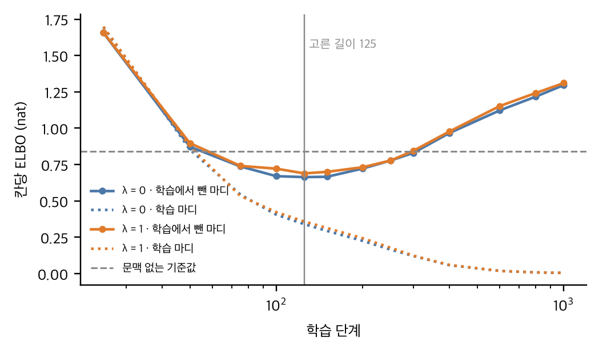

# 부록

부록에는 본문에서 덜어 낸 정의와 식, 설정값(부록 A–G), 이전 실험의 사례 연구(부록 H), 선행 TDA 분석의 재현 세부(부록 I), 실험 실행 기록(부록 J), 생성곡 전체 악보(부록 K)를 모았다. 식 번호는 부록마다 (A1), (B1)처럼 따로 붙인다. 본문의 유형 이름은 대문자 A\~I로 적는다. 부록의 식에서 $a$, $b$, $c$, $c'$, $z$처럼 기울인 소문자로 적은 것은 특정 유형의 이름이 아니라, 아홉 유형 가운데 어느 것이든 가리키는 변수다. 값은 저장소의 구현(`chart_diffusion_v1`, 평가 규약 `chart_eval_v2`)과 같다.

## 부록 A. 편집거리와 유형화

선율은 사건열 $X=(e_1,\dots,e_N)$이고, 사건 $e=(p,d)$는 음높이 $p$(반음 번호, 쉼표는 $\mathrm{r}$)와 길이 $d$(박)의 쌍이다. $t$번째 마디의 사건열을 $\varphi_t$, 그 총음가를 $B_t\in\{4,6\}$으로 쓴다. 두 마디의 거리는 치환·삽입·삭제와, 한 음을 2\~3개로 쪼개거나 합치는 연산을 허용하는 편집거리다. 두 사건 $e=(p,d)$와 $e'=(p',d')$ 사이의 치환 비용과, 사건 하나를 넣거나 빼는 비용은 다음과 같다.

$$c_{\mathrm{sub}}(e,e')=|p-p'|\cdot\frac{d+d'}{2}+|d-d'|\qquad\text{(A1)}$$

$$c_{\mathrm{ins}}(e)=c_{\mathrm{del}}(e)=\alpha\,d\qquad\text{(A2)}$$

두 마디 $\varphi$, $\psi$를 맞추는 정렬 가운데 비용의 합이 가장 작은 것의 비용을 $C(\varphi,\psi)$, 마디 $\varphi$의 총음가를 $D(\varphi)$라 하면, 거리는 이 비용을 두 마디의 총음가 합으로 나눈 값이다.

$$\delta(\varphi,\psi)=\frac{C(\varphi,\psi)}{D(\varphi)+D(\psi)}\qquad\text{(A3)}$$

쉼표와 음의 치환에는 $|p-p'|$ 대신 6을 쓰고, $\alpha=3$이며, 쪼개기·합치기에는 각 치환 비용에 0.5를 더한다. 이 상수는 유형에 맞추어 고르지 않았다. 반음 단위의 조옮김($-12$에서 $+12$ 가운데 최소)을 허용하면 다섯 음 음계를 벗어나는 이동($-9$, $-4$, $-2$반음)으로 마디가 묶였으므로, 곡 안에서는 절대 음높이를 쓴다.

서로 다른 마디 51개에 등장 횟수를 가중치로 준 k-medoids(PAM)를 적용하였다. 같은 마디를 가중치로 한 번만 두면 같은 점이 두 대표형을 차지해 빈 무리가 생기는 문제가 없다. 무리 $c$의 medoid를 대표 마디 $\mu_c$로, 마디 $t$의 유형을 $f_t$로 쓴다. 가중 실루엣은 $k=8$에서 0.425, $k=9$에서 0.424로 국소 최댓값을 이루고 $k=10$에서 0.415로 내려간다. 그 뒤로는 마디 하나로 된 무리가 늘면서 완만하게 오른다($k=17$에서 0.486). 같은 $k=9$에서 이전 작업의 DTW 유형과의 일치도(ARI)는 0.52다. DTW는 한 음을 여러 음에 비용 없이 대응시켜 C C D와 C D D를 거리 0으로 볼 수 있으며, 서양 악곡 네 곡에서는 한 음만 바꾼 변형을 DTW가 거리 0으로 본 비율이 43%였다. 편집거리에는 이 문제가 없다.

## 부록 B. 보존 구조의 정의

원곡의 유형열을 $Y=(f_1,\dots,f_T)$로 쓴다($T=72$). 임의의 유형 $a$ 다음에 임의의 유형 $b$가 온 횟수 $W_{ab}$를 모은 $9\times9$ 표가 전이 그래프의 가중치이고, 한 번이라도 일어난 연결의 집합 $E$가 전이 그래프의 화살표다.

$$W_{ab}=\#\{\,t:\ f_t=a,\ f_{t+1}=b,\ 1\le t<T\,\}\qquad\text{(B1)}$$

$$E=\{\,(a,b):\ W_{ab}>0\,\}\qquad\text{(B2)}$$

환입 관계 $R$은 같은 유형이어야 하는 마디 쌍 $(i,j)$의 집합이다. 〈양청도드리〉에서는 $R=\{(1,25),(2,26),(3,27),(4,28)\}$이다.

$$R\subseteq\{\,(i,j):\ i<j,\ f_i=f_j\,\}\qquad\text{(B3)}$$

〈양청도드리〉에서는 71번의 전이가 41개 간선(자기 전이 7개 포함)에 흩어져 있다. 이전 분석(DTW 기반)에서 서양 악곡 네 곡은 유형의 54\~71%가 다음 유형이 하나로 정해져 있었다. $R$은 장 구조에 근거해 미리 정하였다. 전사에서 자동으로 찾은 2마디 이상의 다른 정확 반복(2\~4마디 = 8\~10마디 = 26\~28마디, 1\~2마디 = 11\~12마디, 7\~8마디 = 51\~52마디, 33\~34마디 = 35\~36마디)은 후보로만 기록하였다. 본문의 생성은 $E$, $R$, 박 수 $B_t$와 처음·끝 유형 $f_1$, $f_T$를 고정하고 새 유형열 $Y'=(f'_1,\dots,f'_T)$과 음표를 새로 정한다.

## 부록 C. 국소 좌표와 프레이즈 다양체

유형이 $c=f_t$인 마디 $\varphi_t$를 식 (A3)의 정렬로 대표 마디 $\mu_c$에 맞추면, $j$번째 사건마다 대표 마디 안의 위치 $u_{tj}$(0 이상 1 미만), 대표음과의 음높이 차 $\eta_{tj}$, 마디 전체의 음역 이동 $s_t$를 얻는다. $\mu_c(u)$는 위치 $u$에서 대표 마디가 울리는 음높이다. 마디의 각 음높이는 다음과 같이 나뉜다.

$$p_{tj}=\mu_c(u_{tj})+s_t+\eta_{tj}\qquad\text{(C1)}$$

한 곡 안에서는 $s_t=0$이다. 유형 F에서 $\eta$의 패턴은 11가지이고 최대 편차는 5반음이다. 생성 모형은 $\mu_c(u)$를 출력의 원점이 아니라 입력의 기준 윤곽으로 쓰고, 음높이는 절대값으로 예측한다.

마디 $\varphi$에 가장 가까운 대표 마디의 유형을 $N_1(\varphi)$, 두 번째로 가까운 대표 마디의 유형을 $N_2(\varphi)$라 하자. 다음을 만족하는 마디 $t$가 하나라도 있으면 두 유형 $c$와 $c'$은 맞닿는다고 한다. 두 번째로 가까운 대표 마디가 여럿이면 각각과 맞닿는다.

$$\{N_1(\varphi_t),\ N_2(\varphi_t)\}=\{c,\ c'\}\qquad\text{(C2)}$$

이는 위상 보존 신경망의 경쟁 헤브 규칙과 같은 정의로, 자료가 놓인 곳에서 대표 마디들의 보로노이 영역이 맞닿는 쌍을 근사한다.[^contact] 〈양청도드리〉에서는 13쌍이 맞닿는다. 원곡에서 유형이 바뀐 56번 가운데 31번(55%)은 맞닿은 유형 사이에서 일어나 닮은 가락으로 이어지고, 나머지는 맞닿지 않은 유형으로 건너뛴다. 곡이 닮은 가락을 잇는지 대비되는 가락으로 넘어가는지를 보여 주는 이 비율은 곡마다 달라서, 서양 악곡 네 곡에서는 10%에서 59%까지 나타났다(표 A1). 이 비율은 곡의 성격을 기술하는 분석 지표이며, 현재의 생성 모형에는 쓰지 않는다.

| 곡 | 유형 수 | 접촉 쌍 | 전이 쌍 | 접촉면을 지나는 전이 |
|:---|:---|:---|:---|:---|
| 양청도드리(피리) | 9 | 13 | 24 | 31/56 (55%) |
| Liebestraum Nr. 3 | 10 | 16 | 19 | 20/34 (59%) |
| Der Lindenbaum | 7 | 5 | 8 | 4/10 (40%) |
| Wachet auf, BWV 140.7 | 5 | 3 | 6 | 1/8 (12%) |
| Maple Leaf Rag | 14 | 10 | 18 | 3/30 (10%) |

Table: 표 A1. 곡별 접촉면 통과율(같은 유형이 이어진 경우는 뺌)

## 부록 D. 새 유형열의 정확 표집

전이 확률 $P_{ab}$는 식 (B1)의 전이 횟수를 행마다 정규화한 것이다.

$$P_{ab}=\frac{W_{ab}}{\sum_{b'}W_{ab'}}\qquad\text{(D1)}$$

새 유형열 $Y'$은 다음 확률에 비례하여 뽑되, 처음과 끝 유형이 원곡과 같고($f'_1=f_1$, $f'_T=f_T$) 환입 관계의 모든 쌍 $(i,j)\in R$에서 $f'_i=f'_j$인 유형열만 허용한다. 조건을 어기는 유형열의 확률은 0이다.

$$\Pr(Y')\ \propto\ \prod_{t=1}^{T-1}P_{f'_t\,f'_{t+1}}\qquad\text{(D2)}$$

아래에서 $(P^n)_{ab}$는 전이 행렬 $P$를 $n$번 곱한 행렬의 $(a,b)$ 성분, 곧 유형 $a$에서 출발해 $n$걸음 뒤에 유형 $b$에 있을 확률이다($P^0$은 단위 행렬). 먼저 환입 구간의 유형 블록 $x=(x_1,\dots,x_L)$을 그 주변 확률로 뽑는다. 출발 구간이 $i_0$번째 마디에서, 되돌아오는 구간이 $j_0$번째 마디에서 시작하고 길이가 $L$일 때, 블록 안의 전이 확률을 $\pi(x)$라 하면 블록의 가중치 $w(x)$는 다음과 같다.

$$\pi(x)=\prod_{k=1}^{L-1}P_{x_k\,x_{k+1}}\qquad\text{(D3)}$$

$$w(x)=(P^{n_1})_{f_1\,x_1}\cdot\pi(x)^2\cdot(P^{n_2})_{x_L\,x_1}\cdot(P^{n_3})_{x_L\,f_T}\qquad\text{(D4)}$$

$$n_1=i_0-1,\qquad n_2=j_0-i_0-L+1,\qquad n_3=T-j_0-L+1$$

$\pi(x)$가 제곱인 것은 같은 블록을 두 번 지나기 때문이다. 〈양청도드리〉는 $i_0=1$, $j_0=25$, $L=4$이므로 $n_1=0$, $n_2=21$, $n_3=44$다. 나머지 구간은 양 끝의 유형을 고정한 다리(bridge) 표집으로 채운다. 곧 $s-1$번째 유형이 $a$이고 구간 끝 $e$번째 유형이 $z$로 정해져 있을 때, $s$번째 유형 $b$는 다음 확률로 뽑는다.

$$\Pr(f'_s=b\mid f'_{s-1}=a,\ f'_e=z)\ \propto\ P_{ab}\cdot(P^{e-s})_{bz}\qquad\text{(D5)}$$

작은 연쇄에서 가능한 유형열을 모두 세어 구한 분포와 표본 분포가 일치했다(총변동 거리 0.03 미만, 2만 표본). 〈양청도드리〉에서 가능한 환입 블록은 71가지이고, 원곡의 블록 ABCC가 나올 확률은 0.29다. 뽑힌 유형열의 전이 횟수와 $W$의 총변동 거리는 평균 0.29(5\~95%: 0.23\~0.37)다.

## 부록 E. 격자 표현, 복원망, 손실함수

한 박을 $\nu$칸으로 나누면 마디 $t$는 $J_t=\nu B_t$칸이 된다($\nu=4$). 칸 $j$의 토큰 $x^j$는 $\mathrm{on}(p)$(음높이 $p$의 새 음), $\mathrm{on}(\mathrm{r})$(쉼의 시작), $\mathrm{hold}$(앞 소리의 이어짐) 가운데 하나이며, 첫 칸은 $\mathrm{hold}$가 될 수 없다. 칸 $j$에서 울리는 상태 $\sigma_j$는 다음과 같다.

$$\sigma_j=\begin{cases}p & x^j=\mathrm{on}(p)\\ \mathrm{r} & x^j=\mathrm{on}(\mathrm{r})\\ \sigma_{j-1} & x^j=\mathrm{hold}\end{cases}\qquad\text{(E1)}$$

유형 $c$의 대표 마디를 위치 $u_j=(j-1)/J_t$에서 읽어 기준 윤곽 $m_c(u_j)$로 쓴다. 복원망은 일부 칸이 가려진 마디와 그 문맥 $\kappa_t$를 받아 가려진 칸마다 원래 토큰의 분포를 낸다. 문맥은 그 마디와 앞뒤 마디의 유형, 박 수, 그리고 이웃 마디와 맞닿는 음이다.

$$\kappa_t=(f_t,\ f_{t-1},\ f_{t+1},\ B_t,\ \beta^-_t,\ \beta^+_t)\qquad\text{(E2)}$$

$\beta^-_t$와 $\beta^+_t$는 앞 마디의 마지막 칸과 뒤 마디의 첫 칸에서 울리는 상태이며, 아직 가려져 있으면 '알 수 없음', 곡의 처음과 끝에서는 '없음' 토큰을 둔다. $\kappa_t$의 앞 네 성분만으로도 곡 안의 한 자리만 가리키는 마디가 72개 중 57개이고 경계 음까지 더하면 63개이므로, 학습 중에는 이웃 유형과 경계 음을 확률 0.5로 함께 가린다. 복원망은 Transformer 부호기(층 3개, 차원 96, 주의 머리 4개, 내부 차원 192, 드롭아웃 0.1, 매개변수 236,363개)이며, 확산 시간을 입력으로 받지 않는다.

순방향 과정은 흡수 상태를 갖는 이산 확산이다. 확산 시간 $r$(0보다 크고 1 이하)에서 각 칸은 서로 독립적으로 확률 $r$로 마스크 $\mathrm{m}$이 되고, 확률 $1-r$로 원래 토큰을 유지한다. 가려진 마디를 $z_r$, 가려진 칸의 집합을 $S_r$이라 하면, 마디 하나에 대한 확산 손실은 다음과 같다.

$$L_{\mathrm{diff}}=\frac{1}{r\,J_t}\sum_{j\in S_r}\left(-\log p_\theta(x^j\mid z_r,\ \kappa_t)\right)\qquad\text{(E3)}$$

학습에서는 이 값을 마디 $t$, 확산 시간 $r$(0.02에서 1 사이의 균등분포), 가림의 무작위성에 대해 평균한다. 이는 연속 시간 ELBO를 칸 수로 나눈 것이다.

구조 손실은 학습 단계마다 식 (D2)에서 새 유형열 $M=8$개를 뽑아, 모든 칸이 가려진 입력에서 한 단계 예측 $\pi_{t,j}$를 얻고 이를 원곡의 유형으로 다시 읽어 계산한다. 먼저 칸마다 울리는 상태의 분포 $q_{t,j}$를 앞 칸부터 차례로 구한다.

$$q_{t,j}(\sigma)=\pi_{t,j}(\mathrm{on}(\sigma))+\pi_{t,j}(\mathrm{hold})\cdot q_{t,j-1}(\sigma)\qquad\text{(E4)}$$

다음으로 마디 $t$가 유형 $c$의 대표 윤곽에서 평균적으로 얼마나 떨어져 있는지를 구한다. 칸 하나의 비용 $\Delta(\sigma,\sigma')$은 두 음높이의 반음 차이이고, 한쪽이 쉼이면 6이다.

$$d_t(c)=\frac{1}{J_t}\sum_{j=1}^{J_t}\sum_{\sigma}q_{t,j}(\sigma)\,\Delta\left(\sigma,\ m_c(u_j)\right)\qquad\text{(E5)}$$

이 거리로 마디 $t$가 유형 $c$로 읽힐 부드러운 확률 $a_t(c)$를 정한다. 온도는 $\gamma=0.5$다.

$$a_t(c)=\frac{\exp(-d_t(c)/\gamma)}{\sum_{c'}\exp(-d_t(c')/\gamma)}\qquad\text{(E6)}$$

이웃한 두 마디의 유형 확률을 곱해 더하면 다시 읽은 전이 표 $\hat W$를 얻는다. 여기서 $a_t$는 아홉 유형의 확률을 늘어놓은 열벡터다.

$$\hat W=\sum_{t=1}^{T-1}a_t\,a_{t+1}^{\top}\qquad\text{(E7)}$$

$b$번째 새 유형열 $Y'^{(b)}$의 전이 표를 $W^{(b)}$, 그 조건에서 다시 읽은 표를 $\hat W^{(b)}$라 하면, 구조 손실과 전체 손실은 다음과 같다.

$$L_{\mathrm{graph}}=\frac{1}{M}\sum_{b=1}^{M}\mathrm{TV}\left(\hat W^{(b)},\ W^{(b)}\right)\qquad\text{(E8)}$$

$$L=L_{\mathrm{diff}}+\lambda(s)\cdot L_{\mathrm{graph}}\qquad\text{(E9)}$$

$\mathrm{TV}(A,B)$는 두 표를 각각 합이 1이 되게 나눈 뒤 같은 칸끼리의 차의 절댓값을 모두 더해 반으로 나눈 값이다. 기울기는 음표 예측에서 상태 분포, 윤곽 거리, 유형 확률을 거쳐서만 흐르며, 유형을 따로 예측하는 출력층은 없다. 윤곽 거리로 원곡 72마디를 다시 판정하면 편집거리 유형과 68마디가 일치한다. 어긋나는 마디(19, 42, 60, 64마디) 가운데 60·64마디는 16칸 대표 마디를 1.5배로 늘인 윤곽과 비교되는 24칸 마디이며, 이 때문에 원곡 음표를 그대로 넣어도 구조 손실은 $\gamma=0.5$에서 0.175다. 원곡 그래프와 비교하는 방식(새 유형열 여러 개를 합친 그래프를 $W$와 비교)은 조건을 완벽히 따르는 모형에서도 표집 잡음만큼 손실이 남아($M=1$일 때 0.29, $M=64$일 때 0.05) 쓰지 않았다.

## 부록 F. 학습·생성 절차와 설정값

학습의 한 단계는 원곡 마디 64개에 대한 확산 손실과 새 유형열 8개(576마디)에 대한 구조 손실로 이루어진다. 구조 손실은 첫 단계부터 켜고, 가중치를 처음 50단계에 걸쳐 0에서 $\lambda$까지 고르게 올린다. $s$는 학습 단계다.

$$\lambda(s)=\lambda\cdot\min(1,\ s/50)\qquad\text{(F1)}$$

$\lambda$는 0, 0.25, 0.5, 1의 네 값을 비교하였고, 같은 학습 길이 실험에서는 0, 0.05, 0.1, 0.15, 0.25, 0.5, 1, 2의 여덟 값을 비교하였다.

학습 길이는 대표 마디 9개를 뺀 서로 다른 마디 42개를 3묶음으로 나누어(내용이 같은 마디는 같은 묶음) 한 묶음씩 빼고 학습하며, 25\~1,000단계에서 뺀 마디의 ELBO를 재어 묶음과 시드의 평균이 가장 낮은 단계로 정한다. 이 값은 $r=0.1, 0.2, \dots, 1.0$에서 가림을 네 번씩 고정해 계산한다. 함께 계산하는 문맥 없는 기준값은 뺀 마디의 각 칸을 박 수가 같은 학습 마디들의 같은 칸 분포(가산 평활 0.5)로 예측한 교차엔트로피다. 가중치 0과 1 모두 125단계에서 가장 낮았고(칸당 0.664, 0.689 nat), 기준값은 0.84였다(그림 A1).

{width=12cm}

생성은 $K=24$단계에 걸쳐 확산 시간을 $r_k=1-k/K$로 내린다. 단계 $k$에서 아직 가려진 칸은 각각 다음 확률로 드러난다.

$$\rho_k=\frac{r_k-r_{k+1}}{r_k}\qquad\text{(F2)}$$

단계마다 72자리를 동시에 복원망에 넣고 이웃 경계 음을 그 단계의 상태에서 다시 읽는다. 환입 짝 $(i,j)\in R$에서는 두 자리가 각자의 문맥으로 낸 예측 $p_i(x)=p_\theta(x\mid z,\ \kappa_i)$와 $p_j(x)=p_\theta(x\mid z,\ \kappa_j)$를 기하평균으로 합친 분포에서 한 번 뽑아 두 자리에 쓴다. 이는 두 로그 확률의 평균을 다시 정규화한 것과 같다.

$$\tilde p(x)\ \propto\ \sqrt{p_i(x)\cdot p_j(x)}\qquad\text{(F3)}$$

기하평균 대신 두 확률을 곱하면(로그 확률을 더하면) 두 예측이 함께 담은 정보를 두 번 세어, 실제로 1\~4마디가 원곡 마디와 같은 비율이 가중치 1에서 74%까지 올랐다. 기하평균으로 바꾼 뒤 이 비율은 26%가 되었다. 다 만든 마디는 편집거리로 자기 대표 마디에 가장 가까운지 확인하고, 어긴 마디(환입 짝은 함께)는 나머지를 고정한 채 최대 4번 다시 만든다.

| 설정 | 값 | 비고 |
|:---|:---|:---|
| 최적화 | AdamW, 학습률 5×10⁻⁴, 가중치 감쇠 0.01 | 처음 100단계 선형 예열, 기울기 노름 1.0 |
| 배치 | 원곡 마디 64개 + 새 유형열 8개 | |
| 확산 시간 하한 | 0.02 | 고정 |
| 문맥 가림 확률 | 0.5 | 고정 |
| 구조 손실 | λ ∈ {0, 0.25, 0.5, 1}(같은 학습 길이 실험은 0\~2의 여덟 값), γ = 0.5, M = 8 | λ는 5.4절의 규칙으로 선택 |
| 학습 길이 | 뺀 마디의 ELBO 최소, 최대 1,000단계. 같은 학습 길이 실험은 125단계로 고정 | 3묶음 × 학습 시드 3개(같은 학습 길이 실험은 시드 15개) |
| 생성 | 24단계, 온도 1, 재생성 최대 4번 | 모형마다 60곡 |

Table: 표 A2. 학습과 생성의 설정값

## 부록 G. 평가 지표의 정의와 판정

마디 수준의 지표는 25\~28마디를 뺀 68자리에서 재고, 곡 단위 지표는 곡을 복원 추출하는 bootstrap(2,000번)으로 95% 구간을 낸다. 생성곡의 각 마디를 식 (A3)으로 가장 가까운 대표 마디의 유형으로 다시 읽어 표면 유형열 $\hat Y=(\hat y_1,\dots,\hat y_T)$를 얻는다.

**구조.** 전이 표를 합이 1이 되게 나눈 것을 $\bar W$로 쓴다. 생성곡의 전이 분포가 원곡과 다른 정도 $\mathrm{TV}$와, 생성곡의 연결 가운데 원곡 그래프에 있는 것의 비율 $\nu_{\mathrm{edge}}$는 다음과 같다.

$$\mathrm{TV}(\hat Y)=\frac{1}{2}\sum_{a,c}\left|\bar W(\hat Y)_{ac}-\bar W_{ac}\right|\qquad\text{(G1)}$$

$$\nu_{\mathrm{edge}}(\hat Y)=\frac{\#\{\,t:\ W_{\hat y_t\,\hat y_{t+1}}>0\,\}}{T-1}\qquad\text{(G2)}$$

**음표 연결의 순환 구조.** 음표 그래프는 서로 다른 (음높이, 음가) 쌍을 정점으로, 연이어 나오는 두 음표를 간선으로 두고 간선 가중치 $w_{ab}$를 그 인접의 횟수로 한다. 두 정점의 거리는 둘을 잇는 경로 $P$ 가운데 $1/w$의 합이 가장 작은 것으로 한다. 선행 연구는 간선 수가 가장 적은 경로를 따라 $1/w$를 더하지만, 그 경로는 동점이 있을 때 점의 기록 순서에 따라 달라지므로(부록 I) 평가에서는 이 거리를 쓴다. 이 값은 경로가 여럿이어도 하나로 정해진다.

$$d(u,v)=\min_{P}\ \sum_{(a,b)\in P}\frac{1}{w_{ab}}\qquad\text{(G3)}$$

이 거리로 Vietoris–Rips 1차원 barcode를 계산하고, 원곡의 barcode(유한 막대 9개)와 bottleneck 거리 $d_B$, 1-Wasserstein 거리 $W_1$로 비교한다. 막대 하나를 (생성, 소멸) 점 $p$로 보고, $\tau$를 대각선을 포함한 두 도표 사이의 일대일 대응이라 하면 다음과 같다.

$$d_B=\min_{\tau}\ \max_{p}\ \|p-\tau(p)\|_\infty\qquad\text{(G4)}$$

$$W_1=\min_{\tau}\ \sum_{p}\|p-\tau(p)\|_\infty\qquad\text{(G5)}$$

**음 분포.** 음정(쉼표는 건너뜀), 음가, 음높이, 음표 3·4-gram의 분포를 원곡과 Jensen–Shannon 발산(밑 2)으로 비교한다. 두 분포 $P$, $Q$의 평균 분포를 $\bar P=(P+Q)/2$라 하면 다음과 같다.

$$\mathrm{JSD}(P,Q)=\frac{1}{2}\mathrm{KL}(P\,\|\,\bar P)+\frac{1}{2}\mathrm{KL}(Q\,\|\,\bar P)\qquad\text{(G6)}$$

마디 사이 편집거리의 분포는 Gauss 핵 밀도 $f$, $g$로 추정해 두 곡선 아래의 겹친 넓이로 비교하며, 기준은 원곡 72마디의 모든 쌍(2,556쌍)이다.

$$\mathrm{OA}(f,g)=\int\min\{f(x),\ g(x)\}\,dx\qquad\text{(G7)}$$

**새로움.** 기준 집합은 서로 다른 원곡 마디 $x_1,\dots,x_N$($N=51$)이고, $\delta_k(x_i)$는 $x_i$에서 $k$번째로 가까운 다른 원곡 마디까지의 거리다($k=5$). 반경은 중복을 뺀 마디로 잡는다. 중복을 넣으면 반복되는 마디의 반경이 0이 되기 때문이다. 생성 마디를 $y_1,\dots,y_{N'}$, 생성 마디 $y_j$에서 가장 가까운 원곡 마디를 $\hat x_j$라 하면 세 지표는 다음과 같다.

$$\mathrm{density}=\frac{1}{k\,N'}\sum_{j=1}^{N'}\#\{\,i:\ d(y_j,x_i)\le\delta_k(x_i)\,\}\qquad\text{(G8)}$$

$$\mathrm{coverage}=\frac{1}{N}\,\#\{\,i:\ \min_j d(y_j,x_i)\le\delta_k(x_i)\,\}\qquad\text{(G9)}$$

$$A=\frac{1}{N'}\,\#\{\,j:\ d(y_j,\hat x_j)\ge\delta_1(\hat x_j)\,\}\qquad\text{(G10)}$$

coverage는 곡 복원 추출에서 아래로 치우치므로 구간을 내지 않는다.

**복제 검정.** 한 묶음을 빼고 고른 길이까지 학습한 모형으로 20곡을 만들고, 생성 마디($m$개)와 뺀 마디($n$개) 각각에서 학습 마디까지의 최근접 거리를 구해 Mann–Whitney $U$로 비교한다. 동점 묶음 $g$의 크기를 $t_g$라 하면, 동점을 보정한 표준편차 $s_U$와 검정 통계량 $Z$는 다음과 같다.

$$s_U^2=\frac{mn}{12}\left[(m+n+1)-\frac{\sum_g(t_g^3-t_g)}{(m+n)(m+n-1)}\right]\qquad\text{(G11)}$$

$$Z=\frac{U-mn/2}{s_U}\qquad\text{(G12)}$$

학습 시드마다 묶음 3개의 $Z$를 Stouffer 방식으로 합친다.

$$Z_{\mathrm{comb}}=\frac{Z_1+Z_2+Z_3}{\sqrt{3}}\qquad\text{(G13)}$$

학습 마디와 똑같은 마디를 양쪽에서 뺀 $Z_{\mathrm{novel}}$로 판정하고, 뺀 비율은 원곡의 반복률(Good–Turing 추정 $1-39/72=0.458$)과 함께 보고한다. 원곡을 다시 뽑아 넣으면 $Z$는 $-2$보다 훨씬 작고 $Z_{\mathrm{novel}}=0$이다.

**비교 대상.** R0은 원곡의 (음높이, 음가) 쌍에서 균등하게, R1은 빈도대로, R2는 원곡 음표열의 1차 Markov 연쇄에서 뽑는다. T0은 각 자리에 같은 유형·같은 박 수의 원곡 마디를 무작위로 골라 붙이고, T2는 T0에서 각 음을 확률 $\rho$로 이웃 음계음으로 옮기고 음가가 다른 이웃 음 쌍을 확률 $\rho/2$로 맞바꾼다($\rho=0.15$, $0.3$). TLJ-A는 선행 TDA 작곡 연구의 첫 번째 알고리즘으로, 각 자리에서 살아 있는 순환들의 공통 음에서 균등하게 뽑고 공통 음이 없으면 빈도 가중 전체에서 뽑는다. 판정 기준 4의 '변형 기준'은 T2($\rho=0.3$)의 authenticity($A$)다.

## 부록 I. 기록 순서에 따른 바코드의 변화

선행 연구의 그래프에서는 서로 다른 (음높이, 음가) 쌍을 점으로, 선율에서 연이어 나오는 두 음을 방향 없이 이은 선으로 두고, 선의 가중치 $w_{ab}$를 두 음이 어느 방향으로든 연이어 나온 횟수로 한다. 점 $u$에서 $v$로 가는 경로 가운데 선의 수가 가장 적은 것을 $P^*(u,v)$라 하면, 두 점 사이의 거리는 이 경로를 따라 $1/w$를 더한 값이다.

$$d_1(u,v)=\sum_{(a,b)\in P^*(u,v)}\frac{1}{w_{ab}}\qquad\text{(I1)}$$

선의 수가 가장 적은 경로가 여럿이면 $P^*$는 하나로 정해지지 않는다. 재구현에서는 단위 가중치의 최단 경로 탐색이 번호가 작은 점을 먼저 방문하도록 하여 동점을 깼다. 따라서 $P^*$, 나아가 $d_1$은 점의 번호, 곧 기록 순서에 따라 정해진다.

〈양청도드리〉 피리 선율에서 점은 47개, 선은 125개다. 연이어 나오는 서로 다른 방향 있는 음 쌍 135가지 가운데 115가지(85.2%)는 반대 방향으로 나타나지 않는다. 점을 음높이, 음가의 순으로 기록했을 때 Vietoris–Rips 1차원 바코드의 막대는 21개였다. 점의 번호를 무작위로 200번 바꾸어 같은 계산을 하자 200개의 바코드가 모두 서로 달랐고, 막대 수는 13\~24개, 음높이 순서의 바코드와의 bottleneck 거리는 중앙값 0.167, 최대 0.190이었다. 지속 호몰로지는 ripser로 계산하였다.

평가(부록 G)에서는 $1/w$의 합이 가장 작은 경로를 쓰는 식 (G3)의 거리를 쓴다. 이 거리는 경로가 여럿이어도 값이 하나로 정해지므로 기록 순서에 의존하지 않는다. 다만 이 경우에도 방향의 손실과 고리 대표의 비유일성은 남는다.

[^contact]: 이는 위상 보존 신경망에서 쓰는 경쟁 헤브 규칙과 같은 정의다. Thomas Martinetz and Klaus Schulten, "Topology Representing Networks," *Neural Networks* 7(3) (1994), pp. 507–522.
