# 국문초록

인공지능으로 국악 선율을 생성하려는 시도 가운데, 위상수학적 데이터 분석(TDA)으로 선율 속의 순환 구조를 찾아 작곡의 원리로 삼은 연구가 있다. 이 방법은 음 하나와 그 다음 음의 연결을 분석의 단위로 삼는다. 그래서 프레이즈가 이어지는 순서나 문헌이 지정한 환입 관계는 직접 다루지 않으며, 생성된 곡이 원곡의 구조를 얼마나 지키는지도 정량적으로 평가되지 않았다. 본 연구는 도드리 계열 악곡을 대상으로, 원곡의 프레이즈 진행과 환입 관계는 지키면서 선율은 새로 만드는 생성 방법을 제안한다.

먼저 원곡의 마디를 선율이 닮은 것끼리 유형으로 묶고, 어떤 유형 뒤에 어떤 유형이 왔는지를 그래프로 정리한다. 새 곡의 유형 순서는 이 그래프에 있는 연결만으로 새로 정한다. 각 마디의 선율은 같은 유형에 속한 원곡 마디들에서 학습한 확산 모델로 채운다. 학습 중에는 원곡에 없는 유형 순서를 주고, 모델이 만든 마디들이 그 순서를 실제로 따르는지를 벌점(구조 손실)으로 더한다. 환입으로 대응하는 두 구간, 곧 〈양청도드리〉의 제1장과 제4장에는 새로 만든 한 선율을 똑같이 쓴다.

〈양청도드리〉 피리 선율(72마디)에 적용한 결과, 구조 손실을 더한 모형에서 생성 마디가 지정된 유형에 속한 비율은 81%에서 94%로 높아졌고, 생성곡의 유형 전이는 99.6%가 원곡 그래프 안에 있었다. 환입 관계는 모든 생성곡에서 음높이와 길이까지 같게 실현되었다. 한편 이 곡은 72마디 가운데 33마디를 곡 안에서 되풀이하므로, 원곡을 베꼈는지에 대한 판정은 이 반복을 고려해야 한다. 본 연구는 이를 위한 평가 설계를 함께 제시한다. 학습 길이를 같게 두고 구조 손실의 가중치를 0에서 2까지 키우면(학습 시드 15개), 생성 마디가 지정된 유형을 따르는 비율이 높아지는 대신 학습한 마디를 조금 바꾼 선율이 늘어나는 맞교환(trade-off)이 나타났으며, 복제 검정의 기준 안에 머무는 범위는 가중치 0.1 안팎까지였다. [기준 방법 및 선행 TDA 작곡 방법과의 비교 결과를 기재한다.] 본 연구는 적은 자료로 학습하는 국악 생성에서, 보존할 구조와 새로 만들 선율을 나누어 정식화하고 그 구분을 평가로 검증하는 한 방법을 제시한다는 데 의의가 있다.

**주제어**: 양청도드리, 환입, 도드리, 국악 생성, 프레이즈 그래프, 확산 모델, 단일 악곡 학습

# 1. 서론

본 연구는 한 악곡의 프레이즈 진행과 프레이즈 사이의 환입 관계를 유지하면서 음표 내용을 새로 생성하는 기계학습 방법을 구현한다. 일반적으로 음악 생성 모델을 학습시키려면 많은 양의 악곡 자료가 필요하다. 자료가 적으면 모델은 학습한 악곡을 그대로 베끼거나, 반대로 음악적 구조가 빈약한 임의의 음표 배열을 만들기 쉽다. 국악은 대중음악처럼 학습용 자료가 풍부하지 않으며, 악곡마다 고유한 음악적·사상적 구조를 지닌다. 그래서 여러 곡을 무작위로 모아 학습하면 생성된 음악이 한 곡의 고유한 성질을 보존한다고 보기 어렵다.

이 문제를 해결하기 위해 본 연구는 각 악곡에 고유한 음악적 구조를 수학적으로 정량화하고, 인공신경망을 학습하는 동안 이 구조를 사전 지식으로 주입한다. 문제에 대한 사전 지식을 학습에 넣어 적은 자료로도 효과적으로 학습시키는 방식은 물리 정보 신경망(Physics-Informed Neural Networks)이나 연산자 학습(operator learning) 등에서 활발히 연구되고 응용되어 왔다.[^pinn] 물리 정보 신경망은 물리 현상을 나타내는 미분방정식을 학습 손실에 더해, 관측 자료가 없는 곳에서도 해가 물리 법칙을 따르게 한다. 본 연구는 이와 같은 방식으로 학습 악곡이 지닌 구조를 학습 손실의 제약 조건으로 부여하여, 생성된 곡이 임의의 음표 배열이 아니라 원래 악곡의 구조를 따르도록 만든다.

한편 생성 모델이 학습 악곡을 그대로 베끼지 않고 새로운 선율을 만들게 하기 위해, 본 연구는 기계학습 분야의 다양체 가설(manifold hypothesis)을 도입한다. 다양체 가설이란 관측되는 자료가 임의의 고차원 공간에 흩뿌려져 있는 것이 아니라 어떤 저차원의 기하학적 구조 위에 놓여 있다는 가설이다.[^manifold] 본 연구는 한 악곡의 선율이 이러한 공간 위를 지나는 하나의 곡선이라고 보고, 원곡에서 그 공간의 뼈대와 살을 함께 추정한 뒤 그 위에서 새 곡선을 뽑는 방식으로 생성을 이해한다. 이 관점은 4.2절에서 자세히 다룬다.

본 연구의 절차는 그림 1과 같이 분석과 생성의 두 단계로 이루어진다. 분석 단계에서는 원곡의 마디를 닮은 것끼리 유형으로 묶고, 유형이 이어지는 순서와 환입 자리를 보존할 구조로 정리한다. 생성 단계에서는 원곡에 있었던 유형 연결만으로 새로운 유형 배열을 정하고, 각 자리에 그 유형다운 새 마디를 채운다. 이 연구의 기여는 다음과 같다. 첫째, 도드리 계열의 형식에서 보존할 것(유형의 연결, 지정된 환입 관계, 마디의 박 수)과 새로 만들 것(유형 배열과 음표)을 구분해 생성 문제를 정의한다. 둘째, 유형마다 국소적인 확산 모델을 학습하고, 원곡에 없는 조건에서 계산한 구조 손실로 국소적으로 만든 선율이 전체 구조를 따르게 한다. 셋째, 환입 관계를 두 구간의 공동 생성으로 정확히 실현하면서도 그 선율 자체는 새로 만든다. 넷째, 원곡 자체가 많은 반복을 지닌다는 사실을 고려하여 반복과 복제를 구별하는 평가 설계를 제시한다.

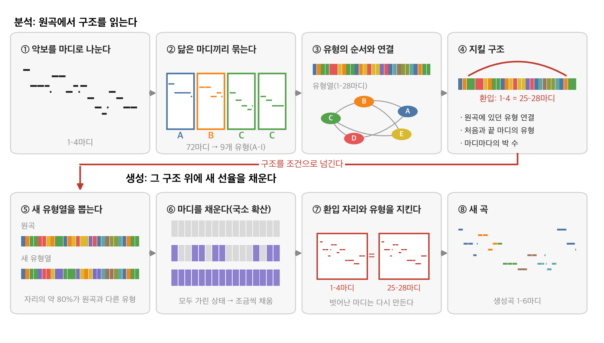{width=16cm}

이 글의 구성은 다음과 같다. 2장에서 환입에 관한 음악학적 논의와 선행 연구를 살피고, 3장에서 연구 대상과 문제를 정의한다. 4장에서 제안 방법을, 5장에서 평가 설계를, 6장에서 결과를 제시하고, 7장에서 논의와 결론을 맺는다. 수학적 정의와 기술적 세부, 사례 연구는 부록에 모았다.

# 2. 음악학적 배경과 선행연구

## 2.1. 환입의 음악학적 논의와 본 연구의 대상

환입의 뜻은 문헌과 용례에 따라 다르게 설명된다. 『국악사전』은 환입(還入)을 '되돌아들다' 또는 '반복하다'라는 뜻으로, 본래 악곡에서 되풀이되는 부분을 가리키는 말로 풀이한다. 송나라 사악(詞樂)인 옛 〈보허자〉와 〈낙양춘〉은 전단의 제2구 이하 선율이 후단에서 다시 나타나는 구조로 되어 있는데, 이 되풀이되는 부분을 환입이라 하고 후단에서 첫 구만 바뀐 부분을 환두(換頭)라 하였다. 그러나 이 말이 곡의 이름에 붙으면서 그 뜻은 넓어졌다. 《영산회상》 계열의 〈상현환입〉이나 〈하현환입〉은 반복하여 연주하던 방식에서 이름을 얻었지만, 〈보허자〉의 환입 부분을 변주하여 파생된 〈미환입〉, 〈세환입〉, 〈양청환입〉의 환입은 반복이 아니라 그 곡의 출처를 가리킨다.[^1] 〈밑도드리〉의 다른 이름인 '미환입'의 환입 역시 선율 단위의 반복과 직접적인 관련이 없는 형식 용어로 보아야 한다는 견해가 있다.[^2] 따라서 곡명에 환입이나 도드리가 붙어 있다는 사실만으로 그 곡 안에 특정한 반복 구조가 있다고 할 수는 없으며, 곡 안의 구조는 따로 확인해야 한다.

곡 안의 구조에 대해서는 도드리 계열의 여러 곡에서 같은 형식이 서술되어 있다. 〈양청도드리〉는 여섯 박 장단인 〈웃도드리〉를 빠른 네 박 장단으로 변주한 곡으로, 국립국악원 『국악사전』은 이 곡을 제1장의 선율이 제4장에서 반복되는 도드리형식으로 설명한다.[^3] 같은 《천년만세》에 속한 〈우조가락도드리〉도 제1장의 선율이 제4장에서 반복되며, 장 구분이 없는 〈계면가락도드리〉에서는 제4\~14장단의 선율이 제32\~42장단에서 반복된다.[^4] 이들의 원류인 〈밑도드리〉에서도 같은 관계가 확인된다.[^5] 『국악전집』 제6집의 해금 선율을 분석한 연구에서 〈밑도드리〉의 제1장과 제4장은 각 4장단으로 선율이 모두 같았고,[^6] 〈밑도드리〉를 한 옥타브 높여 변주한 〈웃도드리〉에 대해서도 제1장과 제4장이 같은 선율이라는 서술이 있다.[^7] 이처럼 악곡 안에서 앞선 장의 선율로 되돌아오는 관계, 특히 제1장이 제4장에서 되풀이되는 관계는 도드리 계열의 여러 곡에서 거듭 나타난다.[^8]

그런데 제1장이 제4장에서 되풀이된다고 해서, 곡 안에서 선율이 되풀이되는 곳이 모두 그러한 관계에 있는 것은 아니다. 〈밑도드리〉 해금 선율을 분석한 연구에 따르면, 이 곡에는 제1장과 제4장 외에도 여러 겹의 되풀이가 있다. 제6장과 제7장은 첫 5장단이 같고, 제2장의 끝 2장단은 제1장과 같으며, 한 장단 길이의 선율이 그대로 되풀이되는 경우도 10종 11회에 이른다.[^9] 같은 연구가 3정간 안팎의 선율 조각을 단위로 분류한 결과, 이 곡의 모든 선율 조각은 15개의 원선율과 그 반복선율, 변형선율로 정리되었다.[^10] 곧 되풀이는 환입의 자리에만 있는 것이 아니라 곡 전체에 걸쳐 있다. 되풀이되는 부분을 부르는 이름도 하나가 아니어서, 앞선 장을 되풀이하는 부분을 환입이 아니라 돌장(回章)이라 부르는 곡도 있다.[^11] 따라서 어떤 되풀이가 환입의 역할을 하는지는 두 선율이 같거나 비슷하다는 사실만으로 정할 수 없으며, 그 구간이 악곡의 형식에서 어떤 위치로 규정되는지에 근거하여 판단해야 한다.

이상의 논의에 근거하여 본 연구는 다루는 대상을 다음과 같이 한정한다. 본 연구에서 '곡 내 환입 관계'란 문헌에 근거하여 악곡 안에서 앞선 특정 구간으로 되돌아가는 것으로 지정한 두 구간 사이의 관계를 말한다. 앞서 살핀 곡들로 보면 〈양청도드리〉, 〈우조가락도드리〉, 〈밑도드리〉의 제1장과 제4장, 〈계면가락도드리〉의 제4\~14장단과 제32\~42장단이 이에 해당한다. 이 정의는 특정 악곡에 한정하지 않고 도드리 계열 악곡에 두루 적용할 수 있도록 세운 것이며, 실제 분석에 쓰는 악곡과 악기, 각 악곡에서 지정한 구간은 3.1절에서 밝힌다. 한편 이 정의는 곡명에 쓰인 환입이나 연주 순서상의 되돌아감을 다루지 않으며, 환입의 역사적 용례 전체를 대표하려는 것도 아니다. 아울러 본 연구는 관계를 지정하는 일과 그 실현 여부를 판정하는 일을 구분한다. 어느 두 구간이 환입의 관계에 있는지는 문헌에 따라 미리 정하고, 생성된 선율에서 그 관계가 실현되었는지는 별도의 선율 비교로 판정한다. 두 구간이 얼마나 같아야 관계가 실현된 것으로 볼지는 3.2절에서 정하며, 앞서 살핀 반복과 변형의 기술 방식은 생성된 선율의 평가 기준을 정하는 데(5장) 참고한다.

## 2.2. 위상수학적 데이터 분석(TDA)에 기반한 국악 연구

국악 선율의 구조를 수학적으로 표현하려는 시도 가운데 위상수학적 데이터 분석(Topological Data Analysis, TDA)을 정간보 선율에 적용한 연구가 있다.[^t21] 이 연구는 해금 선율의 (음높이, 길이) 쌍마다 점을 하나 두고, 곡에서 연이어 나오는 두 음을 선으로 잇는다. 두 음이 연이어 나온 횟수가 많을수록 두 점이 가깝도록 거리를 정한 뒤, 거리의 기준을 조금씩 넓혀 가며 점들 사이에 고리(cycle)가 생기고 사라지는 과정을 기록한다. 이 과정을 지속 호몰로지(persistent homology)라 하고, 각 고리가 살아 있는 거리의 구간을 막대로 늘어놓은 것을 바코드(barcode)라 한다. 오래 살아남은 고리를 곡의 구조적 특징으로 보고, 곡 안의 각 자리에 어떤 고리가 살아 있는지를 표시한 중첩 행렬로 곡을 요약한다. 〈밑도드리〉의 중첩률은 36.23%, 〈웃도드리〉는 32.05%, 타령은 0%로 보고되었다.[^t21b]

이 표현에서 분석의 단위는 음 하나와 바로 다음 음의 쌍이다. 그래프에는 어떤 음 다음에 어떤 음이 몇 번 왔는지만 남으며, 이는 음표를 단위로 한 1차 마르코프 연쇄의 전이 횟수가 담는 정보와 같다. 두 음보다 긴 맥락, 곧 장·장단·악구와 같은 단위나 프레이즈가 어떤 순서로 이어지는지는 그래프에 들어가지 않는다.

이 그래프에서 고리를 찾는 과정에는 몇 가지 수리적 처리가 들어가며, 그 과정에서 음악적 정보 일부가 사라진다. 첫째, 거리를 정하기 위해 한 음에서 다른 음으로 가는 연결과 그 반대 방향의 연결을 합쳐 방향이 없는 선으로 만든다. 같은 정의를 〈양청도드리〉 피리 선율에 적용해 보면, 연이어 나오는 서로 다른 음 쌍 135가지 가운데 115가지(85%)는 한쪽 방향으로만 나타난다. 선율에서 상행과 하행은 서로 다른 의미를 갖지만, 이 그래프에서는 구별되지 않는다. 둘째, 지속 호몰로지가 정하는 것은 고리의 개수와 수명이며, 한 고리를 어떤 음들의 연결로 나타낼지, 곧 고리의 대표는 하나로 정해지지 않는다. 계산이 내놓는 대표에는 실제 선율에 나오지 않는 연결이 섞일 수도 있으며, 이 점은 후속 연구에서도 관찰되었다.[^k22rep] 그러나 음악적 해석은 그 가운데 하나의 대표가 이루는 음들에 기대어 이루어졌다.

셋째, 분석의 결과가 자료를 기록한 순서에 따라 달라질 수 있다. 선행 연구는 두 점 사이의 거리를 두 점을 잇는 선의 수가 가장 적은 경로를 따라 정한다.[^t21d] 그런데 선의 수가 같은 경로가 여럿일 때 어느 경로를 택할지는 밝혀져 있지 않아, 정의를 그대로 구현하면 점을 기록한 순서가 경로를 고르게 된다. 〈양청도드리〉 피리 선율(점 47개, 선 125개)에 이 정의를 적용하고 점을 기록하는 순서만 무작위로 200번 바꾸어 바코드를 다시 계산하자, 200번 모두 바코드가 달라졌다. 1차원 막대의 수는 음높이 순서로 기록했을 때 21개였으나, 순서에 따라 13개에서 24개까지 변하였다(그림 2, 부록 I). 같은 선율과 같은 정의에서 자료를 입력하는 순서만 바꾸어도 분석의 결과가 바뀌는 것이다. 원 연구의 구현이 이 동점을 어떻게 처리했는지는 확인하지 못했으며, 이 결과는 정의를 따른 재구현에서 얻은 것이다.

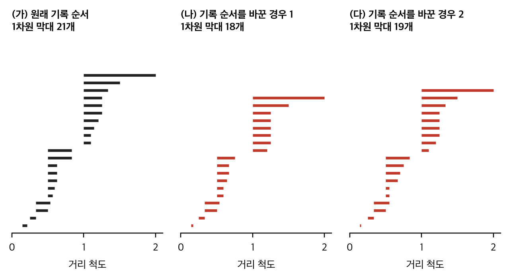{width=16cm}

이 연구들은 국악 선율에 위상수학적 방법을 처음 적용해 곡의 구조를 정량적으로 비교할 수 있는 틀을 제시하였다는 의의가 있다. 다만 위와 같은 수리적 처리로 무엇이 사라지는지, 그리고 그 뒤에 남은 고리가 왜 음악적으로 의미 있는지에 대한 음악적 논증 없이 해석이 이루어졌다. 처음 연구는 순환의 중첩이 도드리 곡에 반복의 느낌을 준다는 가설을 제시하였는데, 그 근거는 '도드리'가 반복으로 번역된다는 사실과의 부합이었다.[^t21c] 이후 이 가설을 지지하는 분석과[^k22] 중첩이 반복 구조보다 선율적 다양성과 관련된다는 해석이[^l24] 함께 제기되었다. 같은 표현을 두고 해석이 엇갈린다는 것은, 수리적 표현과 음악적 의미 사이의 연결이 아직 충분히 논증되지 않았음을 보여 준다.

같은 표현을 생성에 쓴 연구도 있다. 이 연구는 중첩 행렬을 작곡 원리로 삼아, 각 자리에서 살아 있는 순환들의 공통 음 가운데 하나를 고르는 방식과 다층 신경망을 쓰는 방식으로 새 선율을 만들었다.[^t22] 결과는 예시 악보와 연주 영상으로 제시되었고, 생성된 곡의 전체 구조를 분석하여 원곡과 비교하는 일은 앞으로의 과제로 남겨졌다. 같은 연구는 생성된 곡을 다시 분석하면 순환의 수가 줄고(8개에서 4\~6개) 중첩 모양도 원곡과 달라진다고 보고한다.[^t22b] 또한 첫 번째 방식에서는 자리마다 음을 따로 고르므로, 제1장과 제4장의 자리에 같은 순환이 표시되어 있어도 두 장이 음까지 같아질 확률은 자리마다의 확률을 곱한 만큼으로 작아진다. 곧 이 방식으로는 지정된 환입 관계를 보존하면서 그 구간을 새로운 선율로 채우는 일을 함께 이루기 어렵다.

본 연구는 이 계열의 연구와 세 가지 점에서 다르다. 첫째, 분석의 단위를 음 하나가 아니라 마디로 두고, 마디 유형이 나타나는 순서와 방향을 그대로 기록한다. 둘째, 환입은 순환 표현에서 간접적으로 읽어 내지 않고 문헌에 근거해 지정한 관계로 다루며, 생성 과정에서 구성으로 보장한다. 셋째, 생성된 곡의 구조와 새로움을 원곡과 정량적으로 비교하고, 같은 평가에 선행 작곡 방법을 함께 놓는다(5장). 다만 순환 표현이 담는 음 수준의 기하는 본 연구가 보존하려는 구조가 아니므로, 이를 평가의 한 축으로만 쓴다. 이때 기록 순서에 따라 결과가 바뀌지 않도록, 평가에서는 경로를 하나로 정하는 거리를 쓴다(부록 G).

## 2.3. 적은 자료로 학습하는 생성 모델

자료가 적을 때 생성 모델이 학습 자료를 그대로 기억해 되살리는 문제는 영상 생성 분야에서도 보고되어 있다.[^memorize] 한 곡만으로 학습하는 본 연구의 설정에서는 이 위험이 더 크다. 실제로 본 연구의 이전 실험에서는 모형에 곡 안의 위치 정보를 주었을 때 원곡 마디를 그대로 되살리는 현상이 나타났다(부록 H). 그래서 본 연구는 모형이 곡 안의 위치를 알지 못하게 하고, 생성곡이 원곡을 베꼈는지를 따로 확인한다.

자료가 적을 때의 또 다른 문제는 모형이 곡의 구조를 스스로 배우기 어렵다는 점이다. 이를 보완하는 방법은 사람이 아는 구조를 학습에 직접 넣어 주는 것이며, 이러한 방식은 정보 기반 기계학습(informed machine learning)이라는 이름으로 정리되어 있다.[^informed] 그 가운데 물리 정보 신경망은 지배 방정식의 위반량을 자료가 없는 점들에서 계산해 손실에 더한다. 본 연구의 구조 손실은 이 설계를 따르되, 방정식 대신 원곡의 유형 연결 규칙을 쓴다(4.5절). 선율을 만드는 데에는 이산 자료를 위한 확산 모델 가운데 칸을 가렸다가 복원하는 마스크형 확산을 쓴다.[^masked] 이 방식은 마디를 일정한 칸으로 나눈 표현과 잘 맞고, 가린 칸만 새로 채우므로 일부가 정해진 상태에서도 나머지를 생성할 수 있다.

# 3. 연구 대상과 문제 정의

## 3.1. 대상 악곡과 자료

연구 대상은 도드리 계열 악곡이며, 이 글에서는 그 가운데 〈양청도드리〉 피리 선율을 분석한다.[^data] 이 선율은 72마디, 329개의 음표와 쉼표로 이루어진다(표 1). 제1\~6장은 4/4박자, 제7장은 6/4박자로 전사되어 있다. 〈밑도드리〉, 〈웃도드리〉와 다른 선율 악기의 성부에는 자료를 확보하는 대로 같은 절차를 적용한다. 각 악곡을 하나의 학습 단위로 삼으며, 곡 사이에 학습 자료를 섞지 않는다.

| 구간 | 마디 | 박자 | 음표(쉼표) | 빠르기 |
|:---|:---|:---|:---|:---|
| 제1\~6장 | 1\~55 | 4/4 | 240 (0) | ♩ = 180 |
| 제7장 | 56\~72 | 6/4 | 89 (1) | 점2분음표 = 50 |
| 전체 | 72 | — | 329 (1) | 총 322박 |

Table: 표 1. 〈양청도드리〉 피리 선율 전사의 구성

선율은 음표와 쉼표를 시간 순서대로 늘어놓은 것으로 보고, 각 음표를 음높이와 길이의 쌍으로 적는다. 이 곡에는 B♭3에서 F5 사이의 아홉 음높이가 나오며, 음이름으로는 E♭·F·A♭·B♭·C의 다섯 음이다. 이 음들은 각각 황(黃)·태(太)·중(仲)·임(林)·남(南)의 다섯 율명에 대응한다. [아래 옥타브의 B♭3·C4는 배임(倍林)·배남(倍南), 위 옥타브의 E♭5·F5는 청황(潢)·청태(汰)에 해당한다.]{custom-style="Inquiry"} 전사에 함께 적힌 시김새 기호는 현재 표현에 넣지 않았다. 따라서 이 연구가 다루는 것은 골격 가락의 음높이와 리듬이며, 시김새와 농현, 실제 연주의 음향은 범위 밖이다.

## 3.2. 보존할 구조와 새로 만들 선율

본 연구는 한 악곡을 학습해, 그 곡의 프레이즈 진행과 반복 관계를 유지하는 새 선율을 생성하는 문제를 다룬다. 가령 원곡의 앞부분에 나온 선율이 뒷부분에서 그대로 돌아온다면, 생성곡에서도 그 두 자리에 같은 선율이 나타나야 한다. 두 자리에 들어갈 선율은 새로 만들 수 있다. 이 예에서 보존할 것은 선율이 돌아오는 위치와 두 구간의 대응 관계다.

그런데 한 곡의 음표열을 그대로 재현하는 것만으로도 이러한 관계는 충족된다. 따라서 새 선율을 만들려면 보존할 구조와 새로 생성할 음표를 구분해 문제를 설정해야 한다. 이를 위해 원곡을 작은 단위로 나누고, 각 단위의 유형이 나타나는 순서와 반복으로 서로 대응하는 위치를 기록한다. 이 글에서는 그 단위를 마디로 둔다. 〈양청도드리〉 제1\~6장의 전사에서 한 마디는 4박 한 장단에 해당한다.[^jang] 장의 길이는 장마다 달라서, 제1장과 제4장은 네 마디이지만 제3장은 열네 마디다. 환입 관계는 장 단위로 지정되지만(제1장 = 제4장), 장의 길이가 일정하지 않으므로 유형화는 모든 장에 공통된 단위인 마디로 한다. 이후 '프레이즈 그래프'라고 할 때의 프레이즈는 이 마디 단위를 가리킨다.

본 연구가 보존하는 구조는 네 가지다(표 2). 첫째는 유형의 연결이다. 원곡에서 어떤 유형 뒤에 어떤 유형이 왔는지를 모은 전이 그래프를 만들고, 생성곡의 유형 배열은 이 그래프에 있는 연결만 쓴다. 둘째는 처음과 끝 마디의 유형이다. 셋째는 문헌에 근거해 지정한 환입 관계로, 〈양청도드리〉에서는 제1장(1\~4마디)과 제4장(25\~28마디)이 대응한다. 넷째는 마디마다의 박 수다. 반면 유형 배열의 나머지 자리와 모든 마디의 음표는 새로 정한다. 유형 배열까지 원곡과 같게 고정하고 음표만 새로 정하는 방식도 가능하지만, 그러면 곡의 진행이 원곡과 똑같아진다. 본 연구는 원곡에서 일어난 유형 연결의 범위 안에서 진행도 새로 만드는 쪽을 택한다.

| 구분 | 내용 | 실현 방식 |
|:---|:---|:---|
| 보존 | 원곡에 있던 유형 연결만 사용 | 전이 그래프 위에서 유형 배열을 뽑음 |
| 보존 | 처음과 끝 마디의 유형 | 유형 배열의 조건 |
| 보존 | 환입 관계(1\~4마디 = 25\~28마디) | 두 구간을 하나의 선율로 함께 생성 |
| 보존 | 마디마다의 박 수 | 박을 칸으로 나눈 마디 표현 |
| 새로 만듦 | 나머지 자리의 유형 | 유형 배열의 무작위 보행 |
| 새로 만듦 | 모든 마디의 음표 | 유형별 국소 확산 모델 |

Table: 표 2. 보존할 구조와 새로 만들 것

환입 관계가 실현되었다고 볼 기준은 음높이와 길이가 모두 같은 것으로 둔다. 〈양청도드리〉 전사에서 제1장과 제4장은 음높이와 길이가 모두 같기 때문이다. 이 기준은 생성 방법에서 구성으로 보장되며(4.6절), 반복과 변형을 어디까지 같은 관계로 볼지에 대한 음악학적 판단은 다른 악곡으로 넓힐 때 다시 정한다.

# 4. 제안 방법

## 4.1. 마디의 유형화와 프레이즈 그래프

먼저 두 마디가 얼마나 다른지를 정한다. 본 연구는 한 마디를 다른 마디로 바꾸는 데 드는 편집의 양을 거리로 쓴다. 음 하나의 높이를 바꾸거나, 음을 넣거나 빼거나, 한 음을 여러 음으로 쪼개거나 합치는 일에 각각 비용을 매기고, 가장 적은 비용을 두 마디의 길이로 나눈다. 높이를 바꾸는 비용은 음의 차이가 크고 음이 길수록 커진다. 이 거리는 선율 비교를 위해 제안된 편집거리를 따른 것이다.[^mongeau] 한 곡 안에서는 음역이 마디의 성격을 좌우하므로, 음높이는 옮기지 않고 그대로 비교한다.

이 거리로 서로 다른 마디 51개를 아홉 무리로 묶고, 무리마다 그 가운데에 있는 실제 마디 하나를 대표 마디로 삼았다.[^pam] 이 무리를 유형이라 하고 A부터 I까지 이름을 붙였다. 무리의 수 9는 무리가 얼마나 잘 나뉘었는지를 재는 실루엣 값이 국소적으로 가장 큰 자리이며, 그 근처의 다른 선택(8개)과 값의 차이는 작다(부록 A).

마디의 유형을 곡의 순서대로 늘어놓은 것을 유형열이라 한다(그림 3의 (가)). 유형열에서 이웃한 두 마디의 유형 쌍을 모으면 유형을 점으로, 연결을 화살표로 하는 방향 그래프를 얻는데, 이를 프레이즈 그래프 또는 전이 그래프라 부른다(그림 3의 (나)). 〈양청도드리〉에서는 71번의 연결이 41가지 화살표로 나뉜다. 어느 유형이든 그 뒤에 올 수 있는 유형이 둘 이상이다. 예를 들어 유형 A 다음에는 B·F·G가, 유형 C 다음에는 A·C·D·E·F·H의 여섯 유형이 올 수 있다. 원곡에서 같은 유형 뒤에 여러 유형이 왔으므로, 원곡에 있던 연결만 쓰고도 원곡과 다른 진행을 만들 수 있다. 이 그래프가 생성곡이 따라야 할 진행의 규칙이 된다.

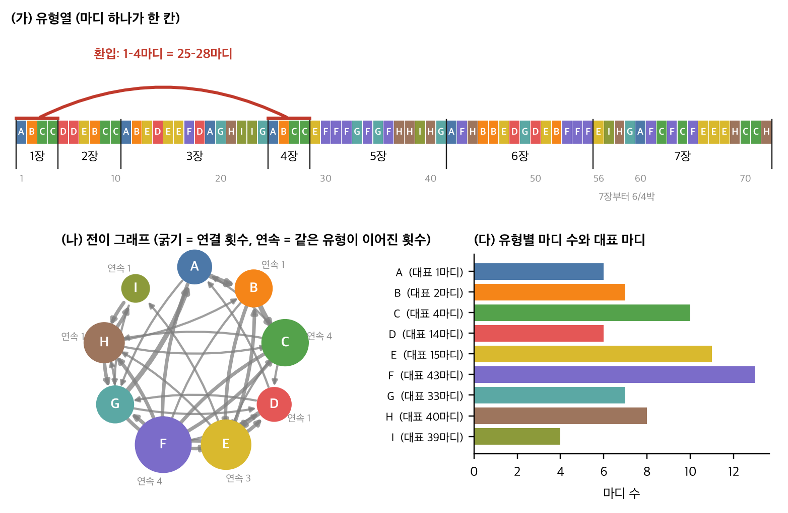{width=16cm}

## 4.2. 프레이즈 다양체: 그래프에 살을 붙이기

프레이즈 그래프는 곡의 뼈대를 보여 준다. 그러나 그래프만으로는 각 유형 안에서 음이 어떻게 움직이는지를 알 수 없다. 그래프의 점 하나는 유형 하나일 뿐이고, 같은 유형의 마디들이 실제로 어떤 음들로 이루어지며 서로 얼마나 다른지는 그래프에 담기지 않는다. 그래프만 따라 곡을 만든다면 각 자리에 대표 마디를 붙이는 것이 최선일 것이고, 그러면 원곡의 진행을 바꾼 짜깁기가 될 뿐 새 선율은 생기지 않는다.

본 연구는 이 빈자리를 다양체 가설로 메운다. 같은 유형의 마디들은 대표 마디를 중심으로 조금씩 다르게 변주된 선율들이다. 이 변주들이 모인 자리를 하나의 덩어리로 보면, 곡의 선율은 이 덩어리들 사이를 오가는 하나의 곡선이 된다(그림 4). 곡선은 한 덩어리 안에 머무는 동안 그 유형의 변주들 사이를 헤매듯 움직이고, 유형이 바뀌는 자리에서 다른 덩어리로 넘어간다. 덩어리를 모두 합친 것을 이 글에서는 프레이즈 다양체라 부른다. 덩어리를 하나의 점으로 줄이면 프레이즈 그래프가 된다. 곧 프레이즈 그래프는 프레이즈 다양체의 뼈대이고, 프레이즈 다양체는 그 뼈대에 유형마다의 선율 변주라는 살을 붙인 것이다. 환입은 이 그림에서 곡선이 앞서 지나간 길을 그대로 한 번 더 지나는 것으로 나타난다.

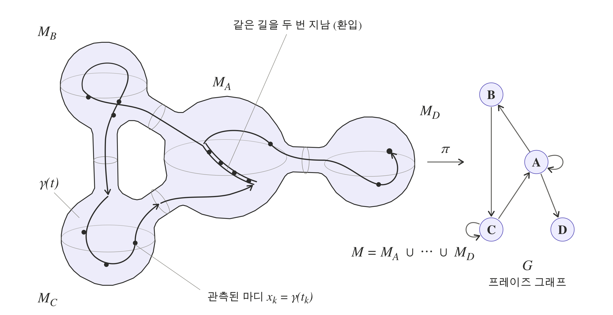{width=16cm}

이 관점에서 본 연구가 하는 일은 세 단계로 정리된다. 먼저 원곡에서 프레이즈 그래프, 곧 뼈대를 뽑는다(4.1절). 다음으로 유형마다 그 유형에 속한 원곡 마디들의 음 분포를 생성 모델로 학습하여 뼈대에 살을 붙이고, 이로써 프레이즈 다양체를 근사한다(4.4절). 마지막으로 근사한 다양체 위에서 새 곡선을 뽑는다. 곡선이 어느 덩어리를 어떤 순서로 지날지는 그래프 위의 새 경로로 정하고(4.3절), 각 덩어리 안에서 곡선이 지나는 자리, 곧 그 마디의 실제 음들은 학습한 분포에서 새로 뽑는다. 이렇게 뽑힌 곡선은 원곡과 같은 뼈대를 따르지만 원곡과 다른 길을 지난다.

덩어리마다 살의 두께, 곧 허용되는 변주의 폭은 다르다. 유형 F를 예로 들면, 13마디 가운데 대표 마디(43마디)와 똑같은 것은 대표 마디 자신뿐이고, 나머지는 대개 한두 음이 이웃 음계음으로 움직이거나 음의 길이가 바뀐 형태다(그림 5의 (가)). 같은 박 위치에서 대표 마디와 다른 음의 비율은 유형 D에서 8%, 유형 B에서 10%에 그치지만, 유형 H에서는 55%에 이른다(그림 5의 (나)). 유형 D의 마디들은 대표 마디를 거의 그대로 되풀이하고, 유형 H의 마디들은 같은 윤곽 위에서 폭넓게 변주된다는 뜻이다. 생성 모델이 유형마다 배워야 하는 것이 바로 이 폭이다. 유형 사이의 닮음, 곧 어떤 덩어리끼리 맞닿아 있는지에 대한 분석은 부록 C에 두었다.

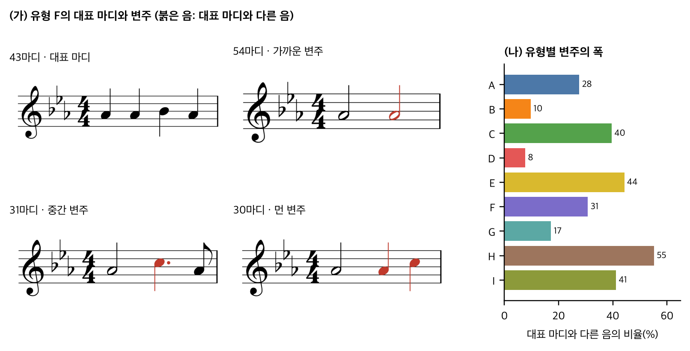{width=16cm}

## 4.3. 새 유형열 만들기

생성은 곡 전체의 유형 배열을 정하는 데서 시작한다. 새 유형열은 원곡의 연결 빈도에 비례하는 확률로 다음 유형을 하나씩 고르는 무작위 보행으로 만든다. 원곡에 없던 연결은 확률이 0이므로, 뽑힌 유형열은 언제나 전이 그래프의 화살표만 따른다. 여기에 두 가지 조건을 더한다. 처음과 끝 마디의 유형은 원곡과 같고, 환입 관계로 대응하는 두 구간은 같은 유형이어야 한다. 멀리 떨어진 두 구간을 같게 맞추는 조건이 있으면 한 걸음씩 고르는 방식으로는 분포를 정확히 맞출 수 없으므로, 조건을 모두 만족하는 유형열 전체의 분포에서 바로 뽑는 방법을 썼다(부록 D).

이렇게 뽑은 유형열 2,000개 가운데 원곡과 같은 것은 하나도 없었고, 평균적으로 자리의 80%에서 원곡과 다른 유형이 나왔다(그림 6). 곧 생성곡은 원곡의 진행 규칙을 따르되 원곡과 다른 진행을 갖는다.

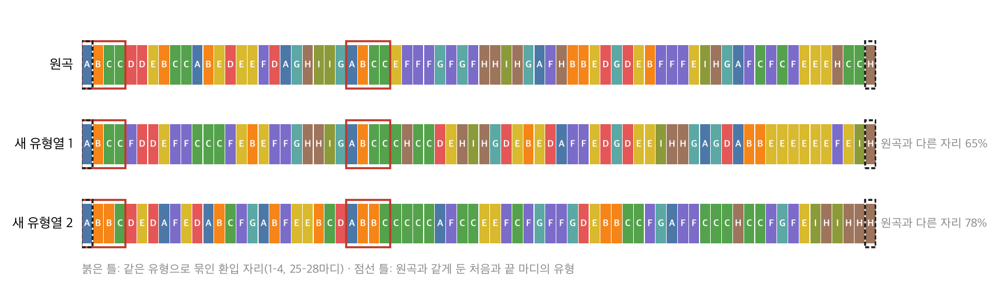{width=16cm}

## 4.4. 국소 확산 모델: 마디의 선율 채우기

유형열이 정해지면 각 자리에 그 유형의 새 마디를 채운다. 이를 위해 마디를 박마다 일정한 수의 칸으로 나눈 격자에 적는다. 각 칸에는 '새 음의 시작', '쉼의 시작', '앞 소리의 이어짐' 가운데 하나를 적는다(그림 7). 첫 칸만 '이어짐'이 아니면 어떤 칸 배열도 올바른 리듬이 되므로, 마디의 박 수는 칸 수로 저절로 맞는다. [〈양청도드리〉 제1\~6장의 장단은 한 박이 세 소박으로 나뉘는 4박 장단(3소박 4박)으로 설명된다.[^sobak] 그러나 현재의 오선보 전사는 4/4박자로 적혀 있고 박 안의 네 번째 자리에서 시작하는 음이 있어, 이 글에서는 전사를 따라 한 박을 네 칸으로 나누었다. 4박 마디는 16칸, 6박 마디는 24칸이다. 정간보 원본에 맞추어 한 박을 세 칸으로 나누는 표현은 전사를 검토한 뒤 적용한다.]{custom-style="Inquiry"}

각 마디의 음은 마스크형 이산 확산 모델로 만든다.[^diffusion] 학습할 때에는 원곡 마디의 칸 일부를 무작위 비율로 가리고, 가린 칸의 원래 내용을 맞히도록 신경망을 학습한다. 생성할 때에는 모든 칸이 가려진 상태(그림 7에서 '?'로 표시한 칸)에서 시작하여, 24단계에 걸쳐 가린 칸을 조금씩 드러내며 채운다. 신경망이 보는 조건은 그 마디의 유형과 대표 마디의 윤곽, 앞뒤 마디의 유형, 박 수, 그리고 이웃 마디와 맞닿는 음이다. 마디는 하나씩 따로 만들지만, 이웃 마디와의 이음새를 매 단계 조건으로 함께 맞춘다. 대표 마디의 윤곽을 기준으로 삼으므로, 신경망은 유형마다 그 윤곽 둘레에서 허용되는 변주를 배우게 된다. 4.2절에서 말한 '뼈대에 살을 붙이는 일'은 이와 같이 한 신경망이 유형과 그 대표 윤곽을 조건으로 받아 영역마다 다른 분포를 내는 방식으로 구현된다.

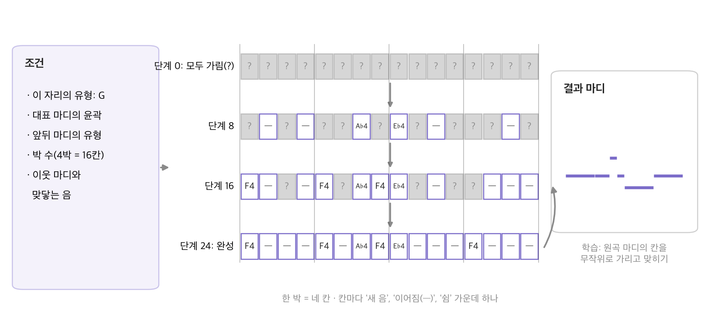{width=16cm}

원곡이 하나뿐이므로 신경망이 원곡 마디를 통째로 외울 위험이 있다(2.3절, 부록 H). 그래서 조건에 장 번호와 장 안의 위치를 넣지 않고, 학습 중에는 절반의 확률로 이웃 마디의 정보를 가린다. 또 원곡의 일부 마디를 빼고 학습하여, 뺀 마디를 가장 잘 설명하는 학습 길이에서 학습을 멈춘다. 〈양청도드리〉에서는 이 길이가 125단계였고, 그보다 오래 학습하면 학습한 마디는 거의 완벽하게 맞히지만 뺀 마디는 점점 더 설명하지 못했다(부록 F).

## 4.5. 음악 구조 손실

신경망은 마디마다 학습하므로, 만든 마디들이 이어졌을 때 주어진 유형열을 실제 소리로 따르는지는 따로 보장되지 않는다. 예컨대 유형 C의 자리에 만든 마디가 소리로는 유형 H에 더 가깝다면, 생성곡의 실제 진행은 주어진 유형열과 달라지고 전이 그래프를 벗어날 수도 있다. 이를 확인하려면 생성된 음표를 다시 유형으로 읽어 그래프를 그리고, 그 그래프를 조건으로 준 유형열의 그래프와 비교하면 된다(그림 8).

그림 8의 (가)는 조건으로 준 새 유형열의 그래프이고, (나)와 (다)는 같은 유형열을 조건으로 두 모형이 만든 음표를 다시 유형으로 읽어 그린 그래프다. 구조 손실 없이 학습한 모형(나)에서는 조건에 없던 연결이 여섯 번 나타났다. 생성된 마디 몇 개가 소리로는 다른 유형에 가까워, 곡의 실제 진행이 주어진 진행에서 벗어난 것이다. 구조 손실을 써서 학습한 모형(다)에서는 조건에 없던 연결이 하나도 나타나지 않았다.

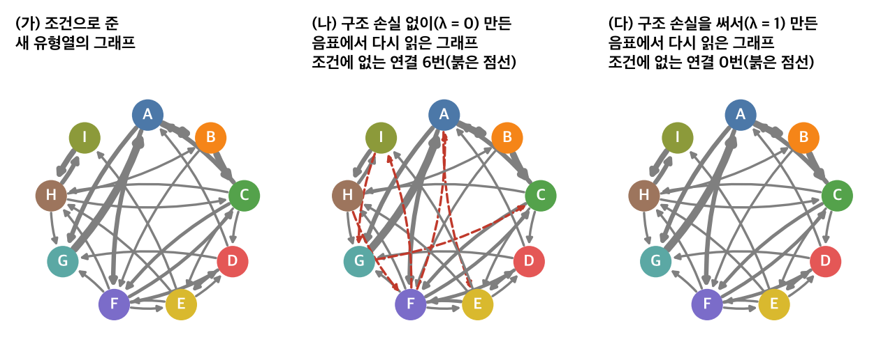{width=16cm}

구조 손실은 이 비교를 학습 단계로 옮긴 것이다. 학습 중에 원곡에 없는 새 유형열을 주고, 신경망이 그 조건에서 만든 마디들을 다시 유형으로 읽는다. 다시 읽은 유형의 연결이 주어진 유형열의 연결과 다른 만큼을 벌점으로 더하며, 이를 구조 손실이라 부른다. 원곡 자료가 없는 조건에서 구조 규칙을 지키게 한다는 점에서, 이는 물리 정보 신경망이 관측 자료가 없는 점들에서 방정식의 위반량을 더하는 것과 같은 구조다. 원곡 마디에 대해서는 가린 칸을 맞히는 확산 손실을, 원곡에 없는 유형열에 대해서는 구조 손실을 계산하여 두 손실의 합으로 학습한다. 구조 손실의 가중치(λ)를 0으로 두면 확산 손실만으로 학습하는 셈이므로, 두 조건을 비교해 구조 손실의 효과를 잴 수 있다. 다시 읽는 과정이 미분 가능해야 학습에 쓸 수 있으므로, 학습 중에는 대표 마디의 윤곽과의 차이로 유형을 부드럽게 판정하고, 생성 후의 확인과 평가는 앞의 편집거리로 한다(부록 E).

## 4.6. 환입의 실현과 유형 확인

환입 관계로 대응하는 두 구간은 하나의 선율로 함께 만든다(그림 9). 생성의 각 단계에서 두 구간은 각자의 앞뒤 문맥으로 예측을 얻는다. 제1장 자리는 곡의 시작과 5마디를, 제4장 자리는 24마디와 29마디를 문맥으로 본다. 두 예측을 고르게 합친 분포에서 한 번 뽑아 두 자리에 같은 음을 쓴다. 따라서 환입은 구성상 정확히 지켜지고, 그 선율은 두 자리의 문맥에 모두 어울리는 것으로 고른 새 선율이 된다. 두 예측을 곱하듯 합치면 두 예측이 함께 담은 정보를 두 번 세게 되어 선율의 선택이 지나치게 좁아지므로, 고르게 합치는 방식을 택했다(부록 F).

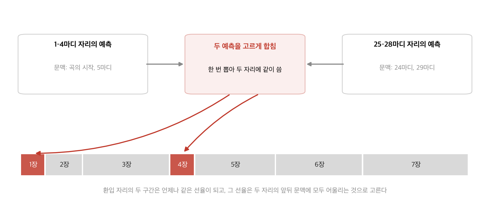{width=16cm}

마지막으로 다 만든 마디가 주어진 유형에 속하는지 확인한다. 마디가 주어진 유형의 대표 마디보다 다른 유형의 대표 마디에 더 가까우면 그 마디만 다시 만들며, 최대 네 번까지 한다. 모형 자체의 능력을 보기 위해, 다시 만들기 전의 소속 비율을 따로 기록하여 평가에 쓴다. 완성된 칸 배열은 음표열로 되돌려 MusicXML 악보로 내보낸다.

# 5. 평가 설계

## 5.1. 네 가지 물음

생성한 곡은 네 가지 물음으로 평가하고, 같은 물음을 비교 대상에도 똑같이 던진다(표 3). 학습 시드를 달리하여 따로 학습한 모형(본실험은 3개, 6.4절의 같은 학습 길이 실험은 15개)이 각각 60곡을 만들며, 결과는 곡 단위의 95% 구간과 함께 보고한다. 환입으로 되풀이되는 25\~28마디는 두 번 세지 않는다. 각 지표의 정의는 부록 G에 있다.

| 물음 | 주요 지표 |
|:---|:---|
| 구조를 지키는가 | 생성 마디가 주어진 유형에 속하는 비율, 생성곡에서 읽은 유형 연결이 원곡 전이 그래프에 있는 비율과 그 차이, 음표 연결의 순환 구조가 원곡과 다른 정도 |
| 원곡의 음 분포에 가까운가 | 음정·음 길이·음높이·짧은 음 패턴(3·4음)의 분포 차이, 마디 사이 거리 분포의 겹침 |
| 기본 규칙을 지키는가 | 음계 밖 음, 박 채움, 격자 밖 시작점(이 연구의 방법에서는 구성상 어길 수 없음), 장 끝음, 곡 끝음 |
| 원곡을 베끼지 않았는가 | 원곡과 똑같은 마디의 비율, 원곡과 이어서 같은 가장 긴 음 구간, 최근접 원곡 마디와의 거리에 기댄 지표(충실도·다양성·복제 여부), 복제 검정 |

Table: 표 3. 평가의 네 가지 물음과 지표

음표 연결의 순환 구조는 2.2절의 선행 연구가 보존하려던 기하다. 이 척도를 함께 쓰면 두 방법을 서로의 기준에서 비교할 수 있다. 음 분포의 차이는 원곡을 그대로 베끼면 가장 작아지므로, 반드시 네 번째 물음과 함께 읽는다.

## 5.2. 비교 대상

비교 대상은 세 묶음이다. 첫째는 원곡의 음을 무작위로 늘어놓은 임의 음악으로, 음의 종류만 따르는 것, 음의 빈도까지 따르는 것, 이웃 음의 연결까지 따르는 것의 세 가지다. 둘째는 각 자리에 같은 유형의 원곡 마디를 골라 붙이거나, 그 마디의 음을 조금 바꾼 것이다. 이 둘은 본 연구와 같은 새 유형열을 쓰므로, 차이는 선율을 만드는 방식에서만 난다. 셋째는 2.2절의 선행 TDA 작곡 방법을 〈양청도드리〉에 적용한 것이다. 첫째 묶음은 임의 음악보다 나은지를, 둘째 묶음은 원곡 마디를 골라 붙이는 것보다 새로운지를, 셋째는 선행 방법보다 합리적인지를 묻는다. [비교 대상의 구현과 결과를 기재한다.]

## 5.3. 반복과 복제의 구별

도드리는 같은 가락을 곡 안에서 자주 되풀이한다. 〈양청도드리〉 피리 선율에서는 72마디 가운데 33마디(46%)가 곡 안의 다른 자리에 똑같이 다시 나온다(그림 10의 (가)). 그러므로 생성곡에 원곡과 똑같은 마디가 나온다는 사실만으로는 베꼈다고 할 수 없다. 원곡의 분포에서 새 마디를 하나 뽑아도 절반 가까이는 이미 있는 마디와 같을 것이기 때문이다.

본 연구는 복제를 두 갈래로 본다. 원곡 마디를 그대로 내는 비율은 원곡 자체의 반복률에 비추어 읽는다. 원곡에 없는 새 마디가 학습한 마디의 작은 변형에 머무는지는 복제 검정으로 판단한다.[^copytest] 복제 검정의 생각은 간단하다. 원곡의 일부 마디를 빼고 모형을 학습한 뒤, 학습에서 뺀 원곡 마디들이 학습한 마디와 얼마나 떨어져 있는지를 기준으로 삼는다. 모형이 원곡을 제대로 일반화했다면, 생성 마디도 학습한 마디에서 그만큼 떨어져 있어야 한다. 생성 마디가 이 기준보다 학습한 마디에 체계적으로 더 가깝다면, 모형은 학습한 마디를 조금 바꾸어 내놓은 것이다. 이때 학습한 마디와 똑같은 마디는 비교에서 뺀다. 뺀 원곡 마디는 구성상 학습한 마디와 같을 수 없어, 그대로 비교하면 원곡처럼 반복하기만 해도 복제로 판정되기 때문이다.

{width=16cm}

## 5.4. 판정 기준과 구조 손실의 가중치 선택

결과는 실행 전에 정한 다섯 기준으로 판정하며, 세 학습 시드 모두에서 성립해야 통과로 본다(표 4).

| 기준 | 통과 조건 |
|:---|:---|
| 1 구조 | 유형 연결의 차이와 순환 구조의 차이가 모두 선행 방법보다 작다 |
| 2 음 분포 | 음정·음 길이·4음 패턴의 분포 차이가 선행 방법과 이웃 음 연결을 따른 임의 음악보다 작고, 마디 거리 분포의 겹침은 크다 |
| 3 규칙 | 규칙 위반이 선행 방법 이하다 |
| 4 복제하지 않음 | 복제 검정을 통과하고, 복제가 아닌 마디의 비율이 변형 기준 이상이며, 원곡 양식에 가까운 정도는 임의 음악과 선행 방법보다 높다 |
| 5 구조 손실의 효과 | 마디가 주어진 유형에 속하는 비율이 구조 손실을 쓰지 않은 모형보다 높다 |

Table: 표 4. 판정 기준

구조 손실의 가중치는 0, 0.25, 0.5, 1의 네 값을 비교하고, 실행 전에 정한 규칙으로 하나를 고른다. 기준 4와 5를 모두 통과하는 가중치 가운데 학습에 쓰지 않은 마디를 가장 잘 설명하는 것을 고른다. 판정에 쓰는 지표로 다시 고르면 같은 지표로 고르고 판정하는 순환이 생기기 때문이다. 다만 기준 4와 5가 선택의 조건에 들어가므로, 고른 가중치에서 두 기준이 통과하는 것은 선택의 결과일 뿐 독립된 증거가 아니다. 독립된 증거는 가중치에 따라 두 값이 어떻게 맞바뀌는지와, 선택에 쓰지 않은 기준 1\~3이다. 실제 실험에서는 이 규칙을 만족하는 가중치가 없었다(6.4절).

# 6. 결과

이 장의 결과는 세 차례의 본실험에서 얻었다(실행 기록은 부록 J). 6.1\~6.3절은 구조 손실의 가중치를 0과 1로 둔 두 조건의 실험이고, 6.4절은 가중치를 0, 0.25, 0.5, 1의 네 값으로 넓힌 실험과, 모든 가중치를 같은 학습 길이로 학습하고 가중치를 0에서 2까지 여덟 단계로 바꾼 실험이다. 앞의 두 실험은 학습 시드 3개, 마지막 실험은 학습 시드 15개로 학습하였고, 모형마다 60곡을 만들었다. 첫 실험은 GPU에서, 나머지 두 실험은 CPU에서 실행하여 같은 가중치에서도 고른 학습 길이와 수치가 조금 다르므로, 수치는 같은 실험 안에서 비교한다. 예를 들어 가중치 0에서 주어진 유형에 속한 마디의 비율은 GPU 실험(표 5)에서 81.2%, 가중치마다 학습 길이를 고른 CPU 실험(표 6, 100단계)에서 75.7%, 학습 길이를 125단계로 고정한 실험(그림 12)에서 81.4%였다. [비교 대상과의 결과를 기재한다.]

## 6.1. 구조의 실현

구조 손실은 생성 마디가 주어진 유형을 따르게 하였다(그림 11의 (가), 표 5). 다시 만들기 전에 생성 마디가 주어진 유형에 속한 비율은 구조 손실이 없을 때 81.2%(시드별 80.1\~83.2%), 있을 때 93.8%(92.9\~94.6%)였으며, 세 시드 모두에서 95% 구간이 겹치지 않았다. 기준 5는 통과하였다. 생성곡에서 다시 읽은 유형 연결이 원곡 전이 그래프에 있는 비율도 98.7%에서 99.6%로 높아졌다. 환입 관계는 공동 생성으로 모든 생성곡에서 음높이와 길이까지 같았다.

생성곡 한 곡의 유형 연결을 원곡과 비교한 차이는 두 조건 모두 0.30 안팎이었다. 이는 모형의 결함이라기보다 조건으로 준 새 유형열 자체가 원곡과 다르기 때문이며, 완벽한 생성기라도 이 값은 평균 0.29 아래로 내려가지 않는다(부록 D). 60곡을 합친 유형 연결은 원곡과의 차이가 0.06으로, 생성곡 전체로는 원곡의 진행 분포를 거의 그대로 재현하였다.

## 6.2. 새로움과 복제

구조 손실은 구조를 높인 대신 원곡과의 거리를 좁혔다. 원곡과 똑같은 마디의 비율은 7.7%에서 14.1%로 늘었고, 복제 검정의 Z값은 구조 손실이 없을 때 −1.0\~−1.3으로 기준(|Z| < 2)을 통과했지만, 있을 때는 −2.3\~−3.6으로 통과하지 못했다(그림 11의 (나)). 곧 구조 손실을 1의 가중치로 준 모형은 원곡 마디를 조금 바꾼 변주를 학습 자료에서 기대되는 것보다 많이 만들었다.

그러나 이 결과를 원곡 마디를 베낀 것으로만 읽기는 어렵다. 원곡 마디가 자기 유형의 대표 마디까지 떨어진 평균 거리는 0.41인데, 구조 손실이 있는 모형의 생성 마디는 0.38, 없는 모형은 0.51이었다(그림 11의 (다)). 대표 마디와 똑같은 마디의 비율도 원곡이 27.9%인 데 비해 생성곡은 각각 13.3%와 6.3%였다. 원곡이 대표 마디를 자주 되풀이하는 곡이므로, 구조 손실이 있는 모형은 대표 마디에 가까이 머무는 정도에서 오히려 원곡과 비슷하고, 구조 손실이 없는 모형은 원곡보다 유형의 중심에서 멀리 흩어져 있다. 이 두 결과를 함께 보면, 구조 손실의 가중치에는 유형을 지키는 정도와 학습 마디에서 벗어나는 정도 사이의 맞교환(trade-off)이 있으며[^tradeoff], 가중치 0과 1 사이에 두 기준을 함께 만족하는 지점이 있을 가능성이 있다. 가중치 0.25와 0.5를 더한 비교는 6.4절에 있다.

환입 자리의 선율은 구조 손실이 있는 모형에서 원곡 마디와 같은 경우가 25.7%로 다른 자리(13.4%)보다 많았다. 두 문맥을 함께 만족하는 선율이 원곡의 해당 마디일 때가 많기 때문으로 보인다.

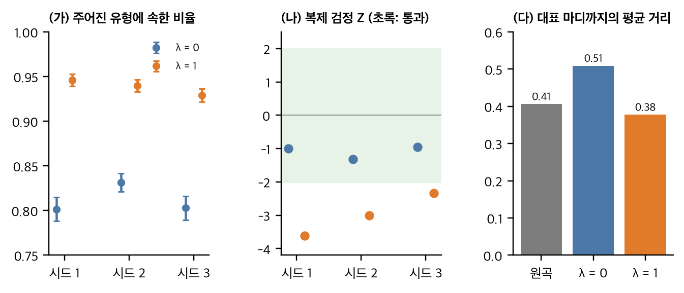{width=16cm}

| 지표 | 가중치 0 | 가중치 1 | 참고 |
|:---|:---|:---|:---|
| 주어진 유형에 속한 비율 | 0.812 | 0.938 | |
| 유형 연결이 원곡 그래프에 있는 비율 | 0.987 | 0.996 | |
| 원곡과 똑같은 마디의 비율 | 0.077 | 0.141 | 원곡 자체의 반복률 0.426 |
| 복제 검정 Z(시드별) | −1.0\~−1.3 | −2.3\~−3.6 | 통과 기준 \|Z\| < 2 |
| 복제가 아닌 마디의 비율 | 0.484 | 0.388 | |
| 원곡과 이어서 같은 가장 긴 구간(음 수) | 7.7 | 8.9 | |
| 음정 분포의 차이(JSD) | 0.082 | 0.076 | |
| 4음 패턴 분포의 차이(JSD) | 0.909 | 0.876 | |
| 장 끝음이 원곡의 장 끝음에 드는 비율 | 0.471 | 0.519 | |
| 곡 끝음이 원곡과 같은 비율 | 0.578 | 0.689 | |
| 음표 연결 순환 구조의 차이(bottleneck) | 0.356 | 0.395 | 원곡의 순환 9개 |

Table: 표 5. 가중치 0과 1의 결과(학습 시드 3개의 평균, 시드마다 60곡). 환입으로 되풀이되는 25\~28마디는 세지 않았다.

## 6.3. 음 분포와 음악 규칙

음계 밖 음, 박 채움 오류, 격자 밖 시작점은 두 조건 모두 0이었다. 이는 마디를 칸으로 나눈 표현에서 구성상 보장되는 결과다. 음정과 음 길이의 분포 차이는 작았고, 구조 손실이 있을 때 음정과 4음 패턴의 분포가 원곡에 조금 더 가까웠다. 장 끝음이 원곡의 장 끝음에 드는 비율은 47\~52%, 곡 끝음이 원곡과 같은 비율은 58\~69%로, 모형이 장 경계를 조건으로 받지 않는 만큼 종지는 약하게 재현되었다. 음표 연결의 순환은 원곡이 9개인 데 비해 생성곡은 평균 13개 안팎이었다. 이 값들이 기준을 통과하는지는 비교 대상과 함께 판정한다. [비교 결과를 기재한다.]

## 6.4. 구조 손실의 가중치에 따른 변화

가중치를 0, 0.25, 0.5, 1로 바꾸면 구조를 지키는 지표와 원곡에서 벗어나는 지표가 한 방향으로 함께 움직였다(표 6). 가중치를 0.25만 주어도 다시 만들기 전에 주어진 유형에 속한 마디의 비율이 75.7%에서 87.8%로 높아졌고, 가중치 1에서는 93.9%였다. 같은 사이에 원곡과 똑같은 마디의 비율은 5.8%에서 11.0%, 15.9%로 늘었고, 원곡에 없는 마디만으로 본 복제 검정 Z는 0 안팎에서 −2.1\~−2.5, −3.7\~−4.1로 낮아졌다. 그 결과 가중치 0.25, 0.5, 1은 모두 세 시드에서 기준 5를 통과하고 기준 4의 복제 검정은 통과하지 못하여, 실행 전에 정한 규칙(5.4절)으로 고를 수 있는 가중치는 없었다.

이 실험에서는 2.2절의 선행 연구가 보존하려던 음표 수준의 기하도 가중치와 함께 원곡에 가까워지는 것처럼 보였다. 원곡의 음표 연결에는 1차원 순환이 9개 있는데, 가중치 0의 생성곡은 평균 19.4개, 가중치 0.5와 1에서는 각각 10.1개와 10.2개였다. 그러나 아래에서 보듯 학습 길이를 같게 맞추면 이 변화는 사라지므로, 이는 가중치가 아니라 학습 길이의 차이에서 온 것이다. 학습에 쓰지 않은 마디를 설명하는 정도는 가중치를 키울수록 조금 나빠졌으나(0.700에서 0.723), 문맥을 쓰지 않는 기준값(0.84)과 비교하면 그 차이는 작았다.

| 지표 | 가중치 0 | 가중치 0.25 | 가중치 0.5 | 가중치 1 | 참고 |
|:---|:---|:---|:---|:---|:---|
| 고른 학습 길이(단계) | 100 | 125 | 150 | 150 | |
| 주어진 유형에 속한 비율 | 0.757 | 0.878 | 0.926 | 0.939 | 다시 만들기 전 |
| 유형 연결이 원곡 그래프에 있는 비율 | 0.981 | 0.992 | 0.994 | 0.995 | |
| 원곡과 똑같은 마디의 비율 | 0.058 | 0.110 | 0.142 | 0.159 | 원곡 자체의 반복률 0.426 |
| 복제 검정 Z(시드별) | −0.3\~0.7 | −2.5\~−2.1 | −3.7\~−3.3 | −4.1\~−3.7 | 통과 기준 \|Z\| < 2 |
| 복제가 아닌 마디의 비율 | 0.526 | 0.410 | 0.379 | 0.358 | |
| 음표 연결 순환의 수 | 19.4 | 13.7 | 10.1 | 10.2 | 원곡 9 |
| 음표 연결 순환 구조의 차이(bottleneck) | 0.436 | 0.392 | 0.340 | 0.342 | |
| 음정 분포의 차이(JSD) | 0.096 | 0.076 | 0.069 | 0.068 | |
| 음 길이 분포의 차이(JSD) | 0.050 | 0.028 | 0.021 | 0.022 | |
| 장 끝음이 원곡의 장 끝음에 드는 비율 | 0.513 | 0.519 | 0.537 | 0.551 | |
| 학습에 쓰지 않은 마디의 설명(보류 ELBO) | 0.700 | 0.709 | 0.716 | 0.723 | 낮을수록 좋음, 문맥 없는 기준 0.84 |

Table: 표 6. 구조 손실의 가중치에 따른 결과(CPU 실험, 학습 시드 3개의 평균, 시드마다 60곡). 환입으로 되풀이되는 25\~28마디는 세지 않았다.

다만 이 실험에서는 가중치마다 학습 길이를 따로 골랐고, 고른 길이가 가중치와 함께 100단계에서 150단계로 늘었다. 학습이 길어질수록 모형은 학습 마디에 가까워지므로, 이 실험에서는 가중치의 효과와 학습 길이의 효과가 섞여 있다. 이를 가르기 위해 모든 가중치를 같은 학습 길이(125단계)로 학습하고, 가중치를 0, 0.05, 0.1, 0.15, 0.25, 0.5, 1, 2의 여덟 단계로 바꾼 실험을 따로 하였다(그림 12). 125단계는 GPU 실험에서 가중치 0과 1이 모두 고른 길이다. 결론이 시드에 따라 흔들리지 않도록 학습 시드를 15개로 늘렸다(가중치마다 900곡).

학습 길이를 같게 하여도 맞교환은 뚜렷하게 나타났다(그림 12). 주어진 유형을 따르는 마디의 비율은 가중치 0의 81.4%에서 가중치 2의 93.6%로 높아졌으며, 가중치를 0.05만 주어도 같은 시드끼리 짝지어 비교한 차이가 유의하였다(윌콕슨 부호순위 검정, 홀름 보정 p = 0.001). 같은 사이에 원곡에 없는 마디의 복제 검정 Z는 평균 −1.39에서 −3.51로 낮아졌고, 이 역시 가중치 0.05부터 유의하였다. 원곡과 음까지 똑같은 마디의 비율은 8.3%에서 15.6%로 늘었으며 가중치 0.15부터 유의한 차이를 보였다. 세 지표 모두 가중치와 강한 순위상관을 보였다(ρ = 0.94, −0.91, 0.81, 모두 p < 0.001).

복제 검정의 평균 Z는 가중치 0.1(−1.83)과 0.15(−2.04) 사이에서 기준값 −2를 지난다. 기준을 통과한 시드의 비율은 가중치 0에서 100%, 0.05에서 87%, 0.1에서 67%, 0.15에서 47%, 0.25에서 20%였고, 0.5 이상에서는 하나도 없었다. 실행 전에 정한 규칙은 모든 시드에서 통과할 것을 요구하므로, 이 규칙으로 고를 수 있는 가중치는 없었다. 다만 시드 평균으로 보면 가중치 0.05와 0.1은 복제 검정의 기준 안에 머무르면서 유형을 따르는 비율을 유의하게 높인다(84.2%, 86.0%). 곧 구조를 지키는 쪽으로 기울일 수 있는 여유는 가중치 0.1 안팎까지이며, 이를 넘으면 새 마디가 학습 마디의 작은 변형으로 몰리기 시작한다. 이는 규칙에 따른 선택이 아니라 결과를 본 뒤의 기술이다.

반면 음표 연결의 순환 구조는 가중치와 무관하였다(그림 12의 (라)). 순환의 수는 모든 가중치에서 평균 12.5\~14.1개로 원곡(9개)보다 많았고, 가중치와의 순위상관은 없었으며(ρ = 0.03, p = 0.76) 어느 가중치도 가중치 0과 유의하게 다르지 않았다. 앞의 실험에서 보인 순환 구조의 변화는 학습 길이에서 온 것이다. 곧 마디의 유형을 지키게 하는 구조 손실은 음 단위의 순환 구조까지 원곡에 가깝게 하지는 않으며, 두 수준의 구조는 서로 다른 장치로 다루어야 한다. 장 끝음이 원곡의 장 끝음에 드는 비율은 48.8%에서 56.0%로 높아져(가중치 0.1부터 유의), 장 경계를 조건으로 받지 않는 모형에서도 구조 손실이 종지의 재현을 조금 도왔다. 그 대가로 학습에 쓰지 않은 마디를 설명하는 정도는 0.695에서 0.747로 나빠졌다(가중치 0.1부터 유의, 그림 12의 (바)).

{width=16cm}

## 6.5. 생성 예

그림 13은 원곡과 생성곡 한 곡의 제1\~4장을 비교한 것이다. 생성곡은 원곡과 다른 유형 진행을 따르고, 1\~4마디에도 원곡 마디를 그대로 쓰지 않았지만, 제4장은 제1장과 음까지 같다. 곧 환입 관계는 원곡의 선율이 아니라 새로 만든 선율 위에서 실현되었다. [전문가의 청취·악보 검토 결과를 기재한다.]

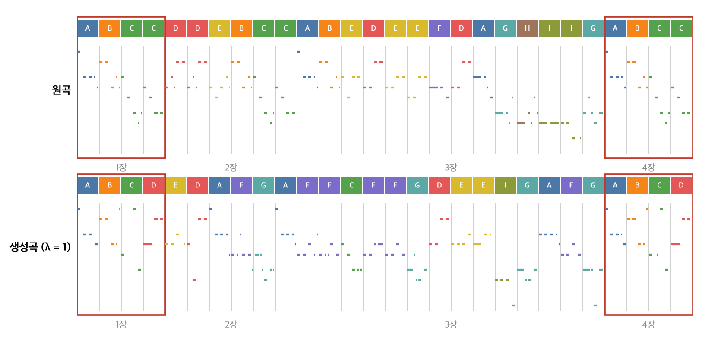{width=16cm}

악보로 보면 가중치의 효과가 더 분명하다. 그림 14는 같은 새 유형열을 조건으로, 가중치만 달리한 네 모형이 만든 19\~24마디다. 이 자리의 유형은 D, D, D, E, D, G이고, 원곡은 같은 자리에서 A, G, H, I, I, G를 따른다. 22마디(유형 E)는 네 모형 모두 유형 E의 대표 마디인 원곡 15마디와 같았다. 나머지 다섯 마디에서 가중치 0의 모형은 원곡 마디를 하나도 쓰지 않고 유형 D와 G의 윤곽을 따라 새 가락을 만들었다. 가중치를 키울수록 유형 D의 대표 마디(원곡 14마디, 같은 가락이 18·48마디에도 나온다)가 그대로 자리를 차지하여, 가중치 1에서는 유형 D의 네 자리 가운데 세 자리가 이 가락이었다. 같은 유형이 이어지는 자리에서 구조 손실이 큰 모형은 유형의 중심 가락을 되풀이하는 쪽을 택한 것이다.

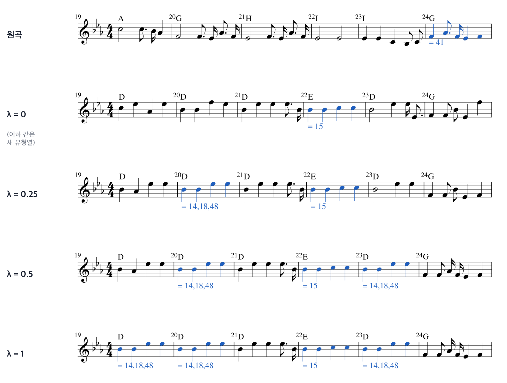{width=16cm}

그림 15는 같은 실험에서 가중치 0.25 모형이 만든 곡의 제1장과 제4장이다. 두 장은 음까지 같고, 원곡 제1장과는 2마디 하나만 같다. 2마디는 원곡에서도 8·12마디에 되풀이되는 가락이다. 나머지 세 마디는 주어진 유형 A, C, H의 새 선율이며, 4마디의 유형 H는 원곡 제1장에 없는 유형으로 새 유형열이 원곡과 다른 진행을 택한 자리다. 곧 환입 관계는 원곡의 제1장이 아니라 새로 만든 제1장 위에서 실현되었다.

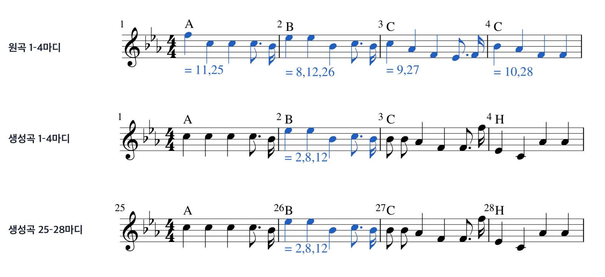{width=16cm}

# 7. 논의와 결론

## 7.1. 반복, 변주, 복제

이 연구에서 가장 분명하게 드러난 것은, 도드리처럼 같은 가락을 거듭 쓰는 곡에서는 '원곡과 같은 마디'와 '베낀 마디'가 같은 말이 아니라는 점이다. 〈양청도드리〉는 72마디 가운데 33마디를 곡 안에서 되풀이하고, 유형마다 대표 마디가 곡의 여러 자리에 그대로 다시 나온다. 생성곡이 원곡과 똑같은 마디를 일부 내는 것은 이 곡의 반복 관습을 따른 결과일 수 있으며, 실제로 구조 손실을 준 모형은 대표 마디에 머무는 정도에서 원곡과 비슷했다. 반면 원곡에 없는 마디가 학습한 마디의 작은 변형에 지나치게 몰려 있다는 것은 복제 검정이 드러낸 별개의 문제다. 두 현상을 구별하지 않고 하나의 복사율로 평가하면, 원곡의 반복을 따르는 생성을 복제로 오판하거나 변형된 복제를 새로운 생성으로 오판할 수 있다.

이 구별은 2.1절의 논의와도 맞닿는다. 되풀이가 환입의 자리에만 있는 것이 아니라 곡 전체에 걸쳐 있다면, 생성에서 지켜야 할 반복은 문헌이 지정한 관계이고, 그 밖의 반복은 곡의 양식으로서 평가할 대상이다. 본 연구는 전자를 구성으로 보장하고, 후자를 원곡의 반복률과 비교하는 방식으로 이 구분을 생성과 평가에 함께 반영하였다.

## 7.2. 한계

첫째, 현재의 수치는 〈양청도드리〉 피리 선율 한 곡에서 얻은 것이다. 가중치 0과 1의 비교와 네 가중치의 비교는 학습 시드 3개, 같은 학습 길이 실험은 학습 시드 15개로 얻었다. 같은 계열의 다른 곡과 성부에 적용하여 결과가 유지되는지 확인해야 한다. 둘째, 마디를 유형화의 단위로 삼은 것과 한 박을 네 칸으로 나눈 것은 현재 전사에 맞춘 작업 설정이며, 장단과 정간보의 단위에 맞는지는 확인이 필요하다. 셋째, 시김새와 농현을 표현에 넣지 않았다. 넷째, 모형은 장 경계를 조건으로 받지 않으므로 종지가 약하게 재현되었고, 마디 사이의 연결은 이웃 경계 음을 조건으로 다룰 뿐 평가에서 직접 재지 않았다. 다섯째, 구조 손실의 가중치 외의 설정값은 고정하였으며, 학습 길이는 대표 마디를 뺀 마디들로 정해졌다. 또 가중치 비교 실험은 계산 장치를 달리하여(GPU와 CPU) 실행되었으며, 같은 가중치에서도 장치에 따라 고른 학습 길이가 달랐다(부록 J). 같은 학습 길이 실험은 학습 시드를 15개로 늘렸으나, 가중치 0.05\~0.25에서는 복제 검정의 통과 여부가 시드에 따라 갈렸다. 여섯째, 규칙 검사는 음악적 타당성의 필요조건일 뿐이며, 전문가 평가로 보완해야 한다.

## 7.3. 결론

본 연구는 한 악곡만으로 학습하는 국악 생성에서, 곡의 구조를 보존할 것과 새로 만들 것으로 나누어 정식화하였다. 원곡의 마디 유형과 그 연결로 프레이즈 다양체의 뼈대를 얻고, 유형마다 학습한 국소 확산 모델로 그 뼈대에 살을 붙인 뒤, 뼈대 위의 새로운 경로를 따라 선율을 뽑았다. 원곡에 없는 조건에서 계산한 구조 손실은 국소적으로 만든 선율이 전체 구조를 따르게 하였고, 환입 관계는 두 구간의 공동 생성으로 새 선율 위에서 정확히 실현되었다. 아울러 원곡 자체의 반복을 고려한 평가 설계로, 구조를 지키는 정도와 원곡에서 벗어나는 정도 사이의 맞교환을 드러냈다. 구조 손실의 가중치를 키우면 마디가 주어진 유형을 따르는 정도와 종지의 재현은 높아지는 대신 학습한 마디를 조금 바꾼 선율이 늘었다. 곧 가중치는 곡의 구조를 얼마나 따를지와 원곡에서 얼마나 벗어날지를 함께 정하는 손잡이 구실을 하며, 〈양청도드리〉 피리 선율에서 복제 검정의 기준 안에 머무는 범위는 가중치 0.1 안팎까지였다. 한편 마디 수준의 구조 손실은 음 단위의 순환 구조를 따로 원곡에 가깝게 하지 않았다. [비교 대상과의 결과에 근거한 결론을 기재한다.]

```{=openxml}
<w:p><w:r><w:br w:type="page"/></w:r></w:p>
```

# 참고문헌

**국내 문헌**

김명옥, 「밑도드리 해금의 TDA Cycle Structure와 선율분석 비교」, 『동양음악』 제51집(서울대학교 동양음악연구소, 2022), 11\~40쪽.

이수경, 「위상수학적 국악 분석에서 사이클의 음악적 의미: 밑도드리, 웃도드리, 타령의 분석을 중심으로」, 『문화와 예술연구』 제27집(동방문화대학원대학교 문화예술콘텐츠연구소, 2024), 241\~267쪽.

국립국악원 편, 『국악전집 제6집: 여민락·도드리』(국립국악원, 1978).

국립국악원 『국악사전』: 「환입」, 「천년만세」, 「양청도드리」, 「우조가락도드리」, 「계면가락도드리」, 「밑도드리」, 「돌장」 항목(2026년 11월 10일·13일 접속).

**국외 문헌**

Alaa, A. M., van Breugel, B., Saveliev, E. and van der Schaar, M., "How Faithful is your Synthetic Data? Sample-level Metrics for Evaluating and Auditing Generative Models," *Proceedings of the 39th International Conference on Machine Learning* (2022).

Austin, J., Johnson, D. D., Ho, J., Tarlow, D. and van den Berg, R., "Structured Denoising Diffusion Models in Discrete State-Spaces," *Advances in Neural Information Processing Systems* 34 (2021).

Bauer, U., "Ripser: Efficient Computation of Vietoris–Rips Persistence Barcodes," *Journal of Applied and Computational Topology* 5 (2021).

Bengio, Y., Courville, A. and Vincent, P., "Representation Learning: A Review and New Perspectives," *IEEE Transactions on Pattern Analysis and Machine Intelligence* 35(8) (2013), pp. 1798–1828.

Carlini, N., Hayes, J., Nasr, M., Jagielski, M., Sehwag, V., Tramèr, F., Balle, B., Ippolito, D. and Wallace, E., "Extracting Training Data from Diffusion Models," *Proceedings of the 32nd USENIX Security Symposium* (2023).

Cohen-Steiner, D., Edelsbrunner, H. and Harer, J., "Stability of Persistence Diagrams," *Discrete & Computational Geometry* 37 (2007).

Ho, J., Jain, A. and Abbeel, P., "Denoising Diffusion Probabilistic Models," *Advances in Neural Information Processing Systems* 33 (2020).

Kaufman, L. and Rousseeuw, P. J., *Finding Groups in Data: An Introduction to Cluster Analysis* (Wiley, 1990).

Lin, J., "Divergence Measures Based on the Shannon Entropy," *IEEE Transactions on Information Theory* 37(1) (1991).

Lu, L., Jin, P., Pang, G., Zhang, Z. and Karniadakis, G. E., "Learning Nonlinear Operators via DeepONet Based on the Universal Approximation Theorem of Operators," *Nature Machine Intelligence* 3 (2021), pp. 218–229.

Martinetz, T. and Schulten, K., "Topology Representing Networks," *Neural Networks* 7(3) (1994), pp. 507–522.

Meehan, C., Chaudhuri, K. and Dasgupta, S., "A Non-Parametric Test to Detect Data-Copying in Generative Models," *Proceedings of the 23rd International Conference on Artificial Intelligence and Statistics* (2020).

Mongeau, M. and Sankoff, D., "Comparison of Musical Sequences," *Computers and the Humanities* 24 (1990), pp. 161–175.

Naeem, M. F., Oh, S. J., Uh, Y., Choi, Y. and Yoo, J., "Reliable Fidelity and Diversity Metrics for Generative Models," *Proceedings of the 37th International Conference on Machine Learning* (2020).

Raissi, M., Perdikaris, P. and Karniadakis, G. E., "Physics-Informed Neural Networks: A Deep Learning Framework for Solving Forward and Inverse Problems Involving Nonlinear Partial Differential Equations," *Journal of Computational Physics* 378 (2019), pp. 686–707.

Rousseeuw, P. J., "Silhouettes: A Graphical Aid to the Interpretation and Validation of Cluster Analysis," *Journal of Computational and Applied Mathematics* 20 (1987), pp. 53–65.

Sahoo, S. S., Arriola, M., Schiff, Y., Gokaslan, A., Marroquin, E., Chiu, J. T., Rush, A. and Kuleshov, V., "Simple and Effective Masked Diffusion Language Models," *Advances in Neural Information Processing Systems* 37 (2024).

Shi, J., Han, K., Wang, Z., Doucet, A. and Titsias, M. K., "Simplified and Generalized Masked Diffusion for Discrete Data," arXiv:2406.04329 (2024).

Tran, M. L., Park, C. and Jung, J.-H., "Topological Data Analysis of Korean Music in Jeongganbo: A Cycle Structure," arXiv:2103.06620 (2021); *Journal of Mathematics and Music* 17(3).

Tran, M. L., Lee, D. and Jung, J.-H., "Machine Composition of Korean Music via Topological Data Analysis and Artificial Neural Network," arXiv:2203.15468 (2022); *Journal of Mathematics and Music*.

Vaswani, A., Shazeer, N., Parmar, N., Uszkoreit, J., Jones, L., Gomez, A. N., Kaiser, Ł. and Polosukhin, I., "Attention Is All You Need," *Advances in Neural Information Processing Systems* 30 (2017).

von Rueden, L. et al., "Informed Machine Learning: A Taxonomy and Survey of Integrating Prior Knowledge into Learning Systems," *IEEE Transactions on Knowledge and Data Engineering* 35(1) (2023), pp. 614–633.

Yang, L.-C. and Lerch, A., "On the Evaluation of Generative Models in Music," *Neural Computing and Applications* 32 (2020).

# Abstract

[영문 초록을 작성한다.]

**Keywords**: Yangcheongdodeuri, hwanip, dodeuri, Korean court music generation, phrase graph, diffusion model, single-piece learning

```{=openxml}
<w:p><w:r><w:br w:type="page"/></w:r></w:p>
```

# 부록

부록에는 본문에서 덜어 낸 정의와 식, 설정값(부록 A–G), 이전 실험의 사례 연구(부록 H), 선행 TDA 분석의 재현 세부(부록 I), 실험 실행 기록(부록 J), 생성곡 전체 악보(부록 K)를 모았다. 식 번호는 부록마다 (A1), (B1)처럼 따로 붙인다. 본문의 유형 이름은 대문자 A\~I로 적는다. 부록의 식에서 $a$, $b$, $c$, $c'$, $z$처럼 기울인 소문자로 적은 것은 특정 유형의 이름이 아니라, 아홉 유형 가운데 어느 것이든 가리키는 변수다. 값은 저장소의 구현(`chart_diffusion_v1`, 평가 규약 `chart_eval_v2`)과 같다.

## 부록 A. 편집거리와 유형화

선율은 사건열 $X=(e_1,\dots,e_N)$이고, 사건 $e=(p,d)$는 음높이 $p$(반음 번호, 쉼표는 $\mathrm{r}$)와 길이 $d$(박)의 쌍이다. $t$번째 마디의 사건열을 $\varphi_t$, 그 총음가를 $B_t\in\{4,6\}$으로 쓴다. 두 마디의 거리는 치환·삽입·삭제와, 한 음을 2\~3개로 쪼개거나 합치는 연산을 허용하는 편집거리다. 두 사건 $e=(p,d)$와 $e'=(p',d')$ 사이의 치환 비용과, 사건 하나를 넣거나 빼는 비용은 다음과 같다.

$$c_{\mathrm{sub}}(e,e')=|p-p'|\cdot\frac{d+d'}{2}+|d-d'|\qquad\text{(A1)}$$

$$c_{\mathrm{ins}}(e)=c_{\mathrm{del}}(e)=\alpha\,d\qquad\text{(A2)}$$

두 마디 $\varphi$, $\psi$를 맞추는 정렬 가운데 비용의 합이 가장 작은 것의 비용을 $C(\varphi,\psi)$, 마디 $\varphi$의 총음가를 $D(\varphi)$라 하면, 거리는 이 비용을 두 마디의 총음가 합으로 나눈 값이다.

$$\delta(\varphi,\psi)=\frac{C(\varphi,\psi)}{D(\varphi)+D(\psi)}\qquad\text{(A3)}$$

쉼표와 음의 치환에는 $|p-p'|$ 대신 6을 쓰고, $\alpha=3$이며, 쪼개기·합치기에는 각 치환 비용에 0.5를 더한다. 이 상수는 유형에 맞추어 고르지 않았다. 반음 단위의 조옮김($-12$에서 $+12$ 가운데 최소)을 허용하면 다섯 음 음계를 벗어나는 이동($-9$, $-4$, $-2$반음)으로 마디가 묶였으므로, 곡 안에서는 절대 음높이를 쓴다.

서로 다른 마디 51개에 등장 횟수를 가중치로 준 k-medoids(PAM)를 적용하였다. 같은 마디를 가중치로 한 번만 두면 같은 점이 두 대표형을 차지해 빈 무리가 생기는 문제가 없다. 무리 $c$의 medoid를 대표 마디 $\mu_c$로, 마디 $t$의 유형을 $f_t$로 쓴다. 가중 실루엣은 $k=8$에서 0.425, $k=9$에서 0.424로 국소 최댓값을 이루고 $k=10$에서 0.415로 내려간다. 그 뒤로는 마디 하나로 된 무리가 늘면서 완만하게 오른다($k=17$에서 0.486). 같은 $k=9$에서 이전 작업의 DTW 유형과의 일치도(ARI)는 0.52다. DTW는 한 음을 여러 음에 비용 없이 대응시켜 C C D와 C D D를 거리 0으로 볼 수 있으며, 서양 악곡 네 곡에서는 한 음만 바꾼 변형을 DTW가 거리 0으로 본 비율이 43%였다. 편집거리에는 이 문제가 없다.

## 부록 B. 보존 구조의 정의

원곡의 유형열을 $Y=(f_1,\dots,f_T)$로 쓴다($T=72$). 임의의 유형 $a$ 다음에 임의의 유형 $b$가 온 횟수 $W_{ab}$를 모은 $9\times9$ 표가 전이 그래프의 가중치이고, 한 번이라도 일어난 연결의 집합 $E$가 전이 그래프의 화살표다.

$$W_{ab}=\#\{\,t:\ f_t=a,\ f_{t+1}=b,\ 1\le t<T\,\}\qquad\text{(B1)}$$

$$E=\{\,(a,b):\ W_{ab}>0\,\}\qquad\text{(B2)}$$

환입 관계 $R$은 같은 유형이어야 하는 마디 쌍 $(i,j)$의 집합이다. 〈양청도드리〉에서는 $R=\{(1,25),(2,26),(3,27),(4,28)\}$이다.

$$R\subseteq\{\,(i,j):\ i<j,\ f_i=f_j\,\}\qquad\text{(B3)}$$

〈양청도드리〉에서는 71번의 전이가 41개 간선(자기 전이 7개 포함)에 흩어져 있다. 이전 분석(DTW 기반)에서 서양 악곡 네 곡은 유형의 54\~71%가 다음 유형이 하나로 정해져 있었다. $R$은 장 구조에 근거해 미리 정하였다. 전사에서 자동으로 찾은 2마디 이상의 다른 정확 반복(2\~4마디 = 8\~10마디 = 26\~28마디, 1\~2마디 = 11\~12마디, 7\~8마디 = 51\~52마디, 33\~34마디 = 35\~36마디)은 후보로만 기록하였다. 본문의 생성은 $E$, $R$, 박 수 $B_t$와 처음·끝 유형 $f_1$, $f_T$를 고정하고 새 유형열 $Y'=(f'_1,\dots,f'_T)$과 음표를 새로 정한다.

## 부록 C. 국소 좌표와 프레이즈 다양체

유형이 $c=f_t$인 마디 $\varphi_t$를 식 (A3)의 정렬로 대표 마디 $\mu_c$에 맞추면, $j$번째 사건마다 대표 마디 안의 위치 $u_{tj}$(0 이상 1 미만), 대표음과의 음높이 차 $\eta_{tj}$, 마디 전체의 음역 이동 $s_t$를 얻는다. $\mu_c(u)$는 위치 $u$에서 대표 마디가 울리는 음높이다. 마디의 각 음높이는 다음과 같이 나뉜다.

$$p_{tj}=\mu_c(u_{tj})+s_t+\eta_{tj}\qquad\text{(C1)}$$

한 곡 안에서는 $s_t=0$이다. 유형 F에서 $\eta$의 패턴은 11가지이고 최대 편차는 5반음이다. 생성 모형은 $\mu_c(u)$를 출력의 원점이 아니라 입력의 기준 윤곽으로 쓰고, 음높이는 절대값으로 예측한다.

마디 $\varphi$에 가장 가까운 대표 마디의 유형을 $N_1(\varphi)$, 두 번째로 가까운 대표 마디의 유형을 $N_2(\varphi)$라 하자. 다음을 만족하는 마디 $t$가 하나라도 있으면 두 유형 $c$와 $c'$은 맞닿는다고 한다. 두 번째로 가까운 대표 마디가 여럿이면 각각과 맞닿는다.

$$\{N_1(\varphi_t),\ N_2(\varphi_t)\}=\{c,\ c'\}\qquad\text{(C2)}$$

이는 위상 보존 신경망의 경쟁 헤브 규칙과 같은 정의로, 자료가 놓인 곳에서 대표 마디들의 보로노이 영역이 맞닿는 쌍을 근사한다.[^contact] 〈양청도드리〉에서는 13쌍이 맞닿는다. 원곡에서 유형이 바뀐 56번 가운데 31번(55%)은 맞닿은 유형 사이에서 일어나 닮은 가락으로 이어지고, 나머지는 맞닿지 않은 유형으로 건너뛴다. 곡이 닮은 가락을 잇는지 대비되는 가락으로 넘어가는지를 보여 주는 이 비율은 곡마다 달라서, 서양 악곡 네 곡에서는 10%에서 59%까지 나타났다(표 A1). 이 비율은 곡의 성격을 기술하는 분석 지표이며, 현재의 생성 모형에는 쓰지 않는다.

| 곡 | 유형 수 | 접촉 쌍 | 전이 쌍 | 접촉면을 지나는 전이 |
|:---|:---|:---|:---|:---|
| 양청도드리(피리) | 9 | 13 | 24 | 31/56 (55%) |
| Liebestraum Nr. 3 | 10 | 16 | 19 | 20/34 (59%) |
| Der Lindenbaum | 7 | 5 | 8 | 4/10 (40%) |
| Wachet auf, BWV 140.7 | 5 | 3 | 6 | 1/8 (12%) |
| Maple Leaf Rag | 14 | 10 | 18 | 3/30 (10%) |

Table: 표 A1. 곡별 접촉면 통과율(같은 유형이 이어진 경우는 뺌)

## 부록 D. 새 유형열의 정확 표집

전이 확률 $P_{ab}$는 식 (B1)의 전이 횟수를 행마다 정규화한 것이다.

$$P_{ab}=\frac{W_{ab}}{\sum_{b'}W_{ab'}}\qquad\text{(D1)}$$

새 유형열 $Y'$은 다음 확률에 비례하여 뽑되, 처음과 끝 유형이 원곡과 같고($f'_1=f_1$, $f'_T=f_T$) 환입 관계의 모든 쌍 $(i,j)\in R$에서 $f'_i=f'_j$인 유형열만 허용한다. 조건을 어기는 유형열의 확률은 0이다.

$$\Pr(Y')\ \propto\ \prod_{t=1}^{T-1}P_{f'_t\,f'_{t+1}}\qquad\text{(D2)}$$

아래에서 $(P^n)_{ab}$는 전이 행렬 $P$를 $n$번 곱한 행렬의 $(a,b)$ 성분, 곧 유형 $a$에서 출발해 $n$걸음 뒤에 유형 $b$에 있을 확률이다($P^0$은 단위 행렬). 먼저 환입 구간의 유형 블록 $x=(x_1,\dots,x_L)$을 그 주변 확률로 뽑는다. 출발 구간이 $i_0$번째 마디에서, 되돌아오는 구간이 $j_0$번째 마디에서 시작하고 길이가 $L$일 때, 블록 안의 전이 확률을 $\pi(x)$라 하면 블록의 가중치 $w(x)$는 다음과 같다.

$$\pi(x)=\prod_{k=1}^{L-1}P_{x_k\,x_{k+1}}\qquad\text{(D3)}$$

$$w(x)=(P^{n_1})_{f_1\,x_1}\cdot\pi(x)^2\cdot(P^{n_2})_{x_L\,x_1}\cdot(P^{n_3})_{x_L\,f_T}\qquad\text{(D4)}$$

$$n_1=i_0-1,\qquad n_2=j_0-i_0-L+1,\qquad n_3=T-j_0-L+1$$

$\pi(x)$가 제곱인 것은 같은 블록을 두 번 지나기 때문이다. 〈양청도드리〉는 $i_0=1$, $j_0=25$, $L=4$이므로 $n_1=0$, $n_2=21$, $n_3=44$다. 나머지 구간은 양 끝의 유형을 고정한 다리(bridge) 표집으로 채운다. 곧 $s-1$번째 유형이 $a$이고 구간 끝 $e$번째 유형이 $z$로 정해져 있을 때, $s$번째 유형 $b$는 다음 확률로 뽑는다.

$$\Pr(f'_s=b\mid f'_{s-1}=a,\ f'_e=z)\ \propto\ P_{ab}\cdot(P^{e-s})_{bz}\qquad\text{(D5)}$$

작은 연쇄에서 가능한 유형열을 모두 세어 구한 분포와 표본 분포가 일치했다(총변동 거리 0.03 미만, 2만 표본). 〈양청도드리〉에서 가능한 환입 블록은 71가지이고, 원곡의 블록 ABCC가 나올 확률은 0.29다. 뽑힌 유형열의 전이 횟수와 $W$의 총변동 거리는 평균 0.29(5\~95%: 0.23\~0.37)다.

## 부록 E. 격자 표현, 복원망, 손실함수

한 박을 $\nu$칸으로 나누면 마디 $t$는 $J_t=\nu B_t$칸이 된다($\nu=4$). 칸 $j$의 토큰 $x^j$는 $\mathrm{on}(p)$(음높이 $p$의 새 음), $\mathrm{on}(\mathrm{r})$(쉼의 시작), $\mathrm{hold}$(앞 소리의 이어짐) 가운데 하나이며, 첫 칸은 $\mathrm{hold}$가 될 수 없다. 칸 $j$에서 울리는 상태 $\sigma_j$는 다음과 같다.

$$\sigma_j=\begin{cases}p & x^j=\mathrm{on}(p)\\ \mathrm{r} & x^j=\mathrm{on}(\mathrm{r})\\ \sigma_{j-1} & x^j=\mathrm{hold}\end{cases}\qquad\text{(E1)}$$

유형 $c$의 대표 마디를 위치 $u_j=(j-1)/J_t$에서 읽어 기준 윤곽 $m_c(u_j)$로 쓴다. 복원망은 일부 칸이 가려진 마디와 그 문맥 $\kappa_t$를 받아 가려진 칸마다 원래 토큰의 분포를 낸다. 문맥은 그 마디와 앞뒤 마디의 유형, 박 수, 그리고 이웃 마디와 맞닿는 음이다.

$$\kappa_t=(f_t,\ f_{t-1},\ f_{t+1},\ B_t,\ \beta^-_t,\ \beta^+_t)\qquad\text{(E2)}$$

$\beta^-_t$와 $\beta^+_t$는 앞 마디의 마지막 칸과 뒤 마디의 첫 칸에서 울리는 상태이며, 아직 가려져 있으면 '알 수 없음', 곡의 처음과 끝에서는 '없음' 토큰을 둔다. $\kappa_t$의 앞 네 성분만으로도 곡 안의 한 자리만 가리키는 마디가 72개 중 57개이고 경계 음까지 더하면 63개이므로, 학습 중에는 이웃 유형과 경계 음을 확률 0.5로 함께 가린다. 복원망은 Transformer 부호기(층 3개, 차원 96, 주의 머리 4개, 내부 차원 192, 드롭아웃 0.1, 매개변수 236,363개)이며, 확산 시간을 입력으로 받지 않는다.

순방향 과정은 흡수 상태를 갖는 이산 확산이다. 확산 시간 $r$(0보다 크고 1 이하)에서 각 칸은 서로 독립적으로 확률 $r$로 마스크 $\mathrm{m}$이 되고, 확률 $1-r$로 원래 토큰을 유지한다. 가려진 마디를 $z_r$, 가려진 칸의 집합을 $S_r$이라 하면, 마디 하나에 대한 확산 손실은 다음과 같다.

$$L_{\mathrm{diff}}=\frac{1}{r\,J_t}\sum_{j\in S_r}\left(-\log p_\theta(x^j\mid z_r,\ \kappa_t)\right)\qquad\text{(E3)}$$

학습에서는 이 값을 마디 $t$, 확산 시간 $r$(0.02에서 1 사이의 균등분포), 가림의 무작위성에 대해 평균한다. 이는 연속 시간 ELBO를 칸 수로 나눈 것이다.

구조 손실은 학습 단계마다 식 (D2)에서 새 유형열 $M=8$개를 뽑아, 모든 칸이 가려진 입력에서 한 단계 예측 $\pi_{t,j}$를 얻고 이를 원곡의 유형으로 다시 읽어 계산한다. 먼저 칸마다 울리는 상태의 분포 $q_{t,j}$를 앞 칸부터 차례로 구한다.

$$q_{t,j}(\sigma)=\pi_{t,j}(\mathrm{on}(\sigma))+\pi_{t,j}(\mathrm{hold})\cdot q_{t,j-1}(\sigma)\qquad\text{(E4)}$$

다음으로 마디 $t$가 유형 $c$의 대표 윤곽에서 평균적으로 얼마나 떨어져 있는지를 구한다. 칸 하나의 비용 $\Delta(\sigma,\sigma')$은 두 음높이의 반음 차이이고, 한쪽이 쉼이면 6이다.

$$d_t(c)=\frac{1}{J_t}\sum_{j=1}^{J_t}\sum_{\sigma}q_{t,j}(\sigma)\,\Delta\left(\sigma,\ m_c(u_j)\right)\qquad\text{(E5)}$$

이 거리로 마디 $t$가 유형 $c$로 읽힐 부드러운 확률 $a_t(c)$를 정한다. 온도는 $\gamma=0.5$다.

$$a_t(c)=\frac{\exp(-d_t(c)/\gamma)}{\sum_{c'}\exp(-d_t(c')/\gamma)}\qquad\text{(E6)}$$

이웃한 두 마디의 유형 확률을 곱해 더하면 다시 읽은 전이 표 $\hat W$를 얻는다. 여기서 $a_t$는 아홉 유형의 확률을 늘어놓은 열벡터다.

$$\hat W=\sum_{t=1}^{T-1}a_t\,a_{t+1}^{\top}\qquad\text{(E7)}$$

$b$번째 새 유형열 $Y'^{(b)}$의 전이 표를 $W^{(b)}$, 그 조건에서 다시 읽은 표를 $\hat W^{(b)}$라 하면, 구조 손실과 전체 손실은 다음과 같다.

$$L_{\mathrm{graph}}=\frac{1}{M}\sum_{b=1}^{M}\mathrm{TV}\left(\hat W^{(b)},\ W^{(b)}\right)\qquad\text{(E8)}$$

$$L=L_{\mathrm{diff}}+\lambda(s)\cdot L_{\mathrm{graph}}\qquad\text{(E9)}$$

$\mathrm{TV}(A,B)$는 두 표를 각각 합이 1이 되게 나눈 뒤 같은 칸끼리의 차의 절댓값을 모두 더해 반으로 나눈 값이다. 기울기는 음표 예측에서 상태 분포, 윤곽 거리, 유형 확률을 거쳐서만 흐르며, 유형을 따로 예측하는 출력층은 없다. 윤곽 거리로 원곡 72마디를 다시 판정하면 편집거리 유형과 68마디가 일치한다. 어긋나는 마디(19, 42, 60, 64마디) 가운데 60·64마디는 16칸 대표 마디를 1.5배로 늘인 윤곽과 비교되는 24칸 마디이며, 이 때문에 원곡 음표를 그대로 넣어도 구조 손실은 $\gamma=0.5$에서 0.175다. 원곡 그래프와 비교하는 방식(새 유형열 여러 개를 합친 그래프를 $W$와 비교)은 조건을 완벽히 따르는 모형에서도 표집 잡음만큼 손실이 남아($M=1$일 때 0.29, $M=64$일 때 0.05) 쓰지 않았다.

## 부록 F. 학습·생성 절차와 설정값

학습의 한 단계는 원곡 마디 64개에 대한 확산 손실과 새 유형열 8개(576마디)에 대한 구조 손실로 이루어진다. 구조 손실은 첫 단계부터 켜고, 가중치를 처음 50단계에 걸쳐 0에서 $\lambda$까지 고르게 올린다. $s$는 학습 단계다.

$$\lambda(s)=\lambda\cdot\min(1,\ s/50)\qquad\text{(F1)}$$

$\lambda$는 0, 0.25, 0.5, 1의 네 값을 비교하였고, 같은 학습 길이 실험에서는 0, 0.05, 0.1, 0.15, 0.25, 0.5, 1, 2의 여덟 값을 비교하였다.

학습 길이는 대표 마디 9개를 뺀 서로 다른 마디 42개를 3묶음으로 나누어(내용이 같은 마디는 같은 묶음) 한 묶음씩 빼고 학습하며, 25\~1,000단계에서 뺀 마디의 ELBO를 재어 묶음과 시드의 평균이 가장 낮은 단계로 정한다. 이 값은 $r=0.1, 0.2, \dots, 1.0$에서 가림을 네 번씩 고정해 계산한다. 함께 계산하는 문맥 없는 기준값은 뺀 마디의 각 칸을 박 수가 같은 학습 마디들의 같은 칸 분포(가산 평활 0.5)로 예측한 교차엔트로피다. 가중치 0과 1 모두 125단계에서 가장 낮았고(칸당 0.664, 0.689 nat), 기준값은 0.84였다(그림 A1).

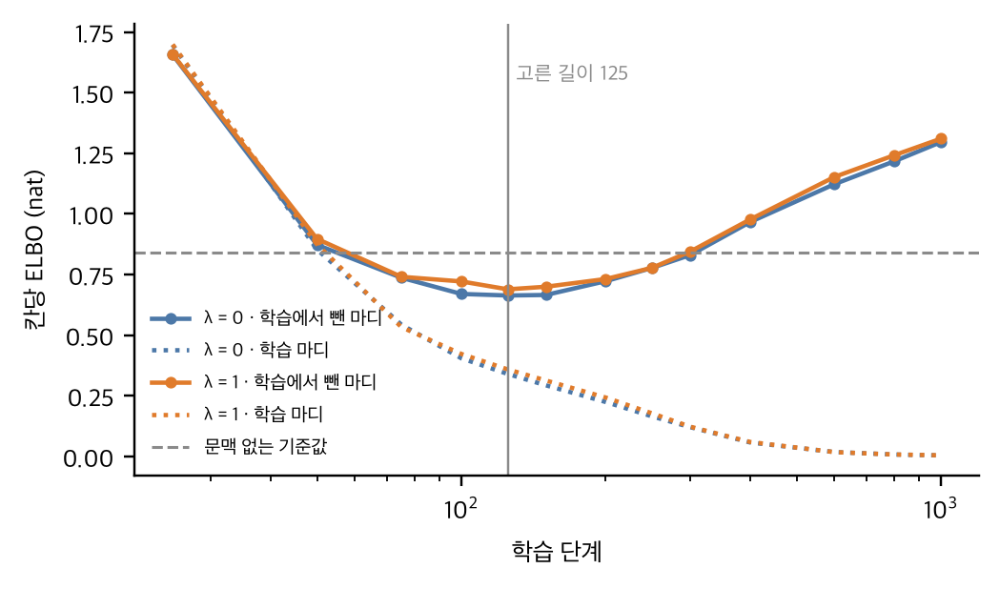{width=12cm}

생성은 $K=24$단계에 걸쳐 확산 시간을 $r_k=1-k/K$로 내린다. 단계 $k$에서 아직 가려진 칸은 각각 다음 확률로 드러난다.

$$\rho_k=\frac{r_k-r_{k+1}}{r_k}\qquad\text{(F2)}$$

단계마다 72자리를 동시에 복원망에 넣고 이웃 경계 음을 그 단계의 상태에서 다시 읽는다. 환입 짝 $(i,j)\in R$에서는 두 자리가 각자의 문맥으로 낸 예측 $p_i(x)=p_\theta(x\mid z,\ \kappa_i)$와 $p_j(x)=p_\theta(x\mid z,\ \kappa_j)$를 기하평균으로 합친 분포에서 한 번 뽑아 두 자리에 쓴다. 이는 두 로그 확률의 평균을 다시 정규화한 것과 같다.

$$\tilde p(x)\ \propto\ \sqrt{p_i(x)\cdot p_j(x)}\qquad\text{(F3)}$$

기하평균 대신 두 확률을 곱하면(로그 확률을 더하면) 두 예측이 함께 담은 정보를 두 번 세어, 실제로 1\~4마디가 원곡 마디와 같은 비율이 가중치 1에서 74%까지 올랐다. 기하평균으로 바꾼 뒤 이 비율은 26%가 되었다. 다 만든 마디는 편집거리로 자기 대표 마디에 가장 가까운지 확인하고, 어긴 마디(환입 짝은 함께)는 나머지를 고정한 채 최대 4번 다시 만든다.

| 설정 | 값 | 비고 |
|:---|:---|:---|
| 최적화 | AdamW, 학습률 5×10⁻⁴, 가중치 감쇠 0.01 | 처음 100단계 선형 예열, 기울기 노름 1.0 |
| 배치 | 원곡 마디 64개 + 새 유형열 8개 | |
| 확산 시간 하한 | 0.02 | 고정 |
| 문맥 가림 확률 | 0.5 | 고정 |
| 구조 손실 | λ ∈ {0, 0.25, 0.5, 1}(같은 학습 길이 실험은 0\~2의 여덟 값), γ = 0.5, M = 8 | λ는 5.4절의 규칙으로 선택 |
| 학습 길이 | 뺀 마디의 ELBO 최소, 최대 1,000단계. 같은 학습 길이 실험은 125단계로 고정 | 3묶음 × 학습 시드 3개(같은 학습 길이 실험은 시드 15개) |
| 생성 | 24단계, 온도 1, 재생성 최대 4번 | 모형마다 60곡 |

Table: 표 A2. 학습과 생성의 설정값

## 부록 G. 평가 지표의 정의와 판정

마디 수준의 지표는 25\~28마디를 뺀 68자리에서 재고, 곡 단위 지표는 곡을 복원 추출하는 bootstrap(2,000번)으로 95% 구간을 낸다. 생성곡의 각 마디를 식 (A3)으로 가장 가까운 대표 마디의 유형으로 다시 읽어 표면 유형열 $\hat Y=(\hat y_1,\dots,\hat y_T)$를 얻는다.

**구조.** 전이 표를 합이 1이 되게 나눈 것을 $\bar W$로 쓴다. 생성곡의 전이 분포가 원곡과 다른 정도 $\mathrm{TV}$와, 생성곡의 연결 가운데 원곡 그래프에 있는 것의 비율 $\nu_{\mathrm{edge}}$는 다음과 같다.

$$\mathrm{TV}(\hat Y)=\frac{1}{2}\sum_{a,c}\left|\bar W(\hat Y)_{ac}-\bar W_{ac}\right|\qquad\text{(G1)}$$

$$\nu_{\mathrm{edge}}(\hat Y)=\frac{\#\{\,t:\ W_{\hat y_t\,\hat y_{t+1}}>0\,\}}{T-1}\qquad\text{(G2)}$$

**음표 연결의 순환 구조.** 음표 그래프는 서로 다른 (음높이, 음가) 쌍을 정점으로, 연이어 나오는 두 음표를 간선으로 두고 간선 가중치 $w_{ab}$를 그 인접의 횟수로 한다. 두 정점의 거리는 둘을 잇는 경로 $P$ 가운데 $1/w$의 합이 가장 작은 것으로 한다. 선행 연구는 간선 수가 가장 적은 경로를 따라 $1/w$를 더하지만, 그 경로는 동점이 있을 때 점의 기록 순서에 따라 달라지므로(부록 I) 평가에서는 이 거리를 쓴다. 이 값은 경로가 여럿이어도 하나로 정해진다.

$$d(u,v)=\min_{P}\ \sum_{(a,b)\in P}\frac{1}{w_{ab}}\qquad\text{(G3)}$$

이 거리로 Vietoris–Rips 1차원 barcode를 계산하고, 원곡의 barcode(유한 막대 9개)와 bottleneck 거리 $d_B$, 1-Wasserstein 거리 $W_1$로 비교한다. 막대 하나를 (생성, 소멸) 점 $p$로 보고, $\tau$를 대각선을 포함한 두 도표 사이의 일대일 대응이라 하면 다음과 같다.

$$d_B=\min_{\tau}\ \max_{p}\ \|p-\tau(p)\|_\infty\qquad\text{(G4)}$$

$$W_1=\min_{\tau}\ \sum_{p}\|p-\tau(p)\|_\infty\qquad\text{(G5)}$$

**음 분포.** 음정(쉼표는 건너뜀), 음가, 음높이, 음표 3·4-gram의 분포를 원곡과 Jensen–Shannon 발산(밑 2)으로 비교한다. 두 분포 $P$, $Q$의 평균 분포를 $\bar P=(P+Q)/2$라 하면 다음과 같다.

$$\mathrm{JSD}(P,Q)=\frac{1}{2}\mathrm{KL}(P\,\|\,\bar P)+\frac{1}{2}\mathrm{KL}(Q\,\|\,\bar P)\qquad\text{(G6)}$$

마디 사이 편집거리의 분포는 Gauss 핵 밀도 $f$, $g$로 추정해 두 곡선 아래의 겹친 넓이로 비교하며, 기준은 원곡 72마디의 모든 쌍(2,556쌍)이다.

$$\mathrm{OA}(f,g)=\int\min\{f(x),\ g(x)\}\,dx\qquad\text{(G7)}$$

**새로움.** 기준 집합은 서로 다른 원곡 마디 $x_1,\dots,x_N$($N=51$)이고, $\delta_k(x_i)$는 $x_i$에서 $k$번째로 가까운 다른 원곡 마디까지의 거리다($k=5$). 반경은 중복을 뺀 마디로 잡는다. 중복을 넣으면 반복되는 마디의 반경이 0이 되기 때문이다. 생성 마디를 $y_1,\dots,y_{N'}$, 생성 마디 $y_j$에서 가장 가까운 원곡 마디를 $\hat x_j$라 하면 세 지표는 다음과 같다.

$$\mathrm{density}=\frac{1}{k\,N'}\sum_{j=1}^{N'}\#\{\,i:\ d(y_j,x_i)\le\delta_k(x_i)\,\}\qquad\text{(G8)}$$

$$\mathrm{coverage}=\frac{1}{N}\,\#\{\,i:\ \min_j d(y_j,x_i)\le\delta_k(x_i)\,\}\qquad\text{(G9)}$$

$$A=\frac{1}{N'}\,\#\{\,j:\ d(y_j,\hat x_j)\ge\delta_1(\hat x_j)\,\}\qquad\text{(G10)}$$

coverage는 곡 복원 추출에서 아래로 치우치므로 구간을 내지 않는다.

**복제 검정.** 한 묶음을 빼고 고른 길이까지 학습한 모형으로 20곡을 만들고, 생성 마디($m$개)와 뺀 마디($n$개) 각각에서 학습 마디까지의 최근접 거리를 구해 Mann–Whitney $U$로 비교한다. 동점 묶음 $g$의 크기를 $t_g$라 하면, 동점을 보정한 표준편차 $s_U$와 검정 통계량 $Z$는 다음과 같다.

$$s_U^2=\frac{mn}{12}\left[(m+n+1)-\frac{\sum_g(t_g^3-t_g)}{(m+n)(m+n-1)}\right]\qquad\text{(G11)}$$

$$Z=\frac{U-mn/2}{s_U}\qquad\text{(G12)}$$

학습 시드마다 묶음 3개의 $Z$를 Stouffer 방식으로 합친다.

$$Z_{\mathrm{comb}}=\frac{Z_1+Z_2+Z_3}{\sqrt{3}}\qquad\text{(G13)}$$

학습 마디와 똑같은 마디를 양쪽에서 뺀 $Z_{\mathrm{novel}}$로 판정하고, 뺀 비율은 원곡의 반복률(Good–Turing 추정 $1-39/72=0.458$)과 함께 보고한다. 원곡을 다시 뽑아 넣으면 $Z$는 $-2$보다 훨씬 작고 $Z_{\mathrm{novel}}=0$이다.

**비교 대상.** R0은 원곡의 (음높이, 음가) 쌍에서 균등하게, R1은 빈도대로, R2는 원곡 음표열의 1차 Markov 연쇄에서 뽑는다. T0은 각 자리에 같은 유형·같은 박 수의 원곡 마디를 무작위로 골라 붙이고, T2는 T0에서 각 음을 확률 $\rho$로 이웃 음계음으로 옮기고 음가가 다른 이웃 음 쌍을 확률 $\rho/2$로 맞바꾼다($\rho=0.15$, $0.3$). TLJ-A는 선행 TDA 작곡 연구의 첫 번째 알고리즘으로, 각 자리에서 살아 있는 순환들의 공통 음에서 균등하게 뽑고 공통 음이 없으면 빈도 가중 전체에서 뽑는다. 판정 기준 4의 '변형 기준'은 T2($\rho=0.3$)의 authenticity($A$)다.


## 부록 H. 사례 연구: 곡 안의 위치를 외운 모형

본문 2.3절과 4.4절에서 모형에 곡 안의 위치를 주지 않은 까닭을 이전 실험(2026년 10월)의 결과로 보인다. 이 실험의 모형은 마디의 장 번호, 박자, 장 안의 위치 구간(네 구간)을 조건으로 받는 확산 모형으로, 현재의 모형과 구조가 다르다. 수치는 모두 〈양청도드리〉 피리 선율에서 얻었다.

**겉보기의 환입.** 이 모형이 만든 60곡 가운데 21곡에서 생성곡의 제1장과 제4장이 네 마디 모두 같았고, 다른 21곡에서는 세 마디가 같았다. 그러나 두 장이 같은 자리에서 일치한 180마디는 모두 원곡 제1장의 마디였다. 새로 만든 선율이 제4장에서 되풀이된 경우는 없었다.

**원인.** (장, 박자, 위치 구간)의 조합이 원곡 마디 하나만을 가리키는 경우가 72마디 가운데 12마디였고, 제1장과 제4장의 8마디가 모두 여기에 속했다. 모든 음을 가린 입력에서 모형은 이 12마디를 100% 원곡 그대로 복원했고, 조합이 여러 마디에 공유되는 나머지 60마디에서는 15\~18%만 복원했다. 제1장의 장 번호를 3으로 바꾸거나 위치 구간을 뒤집으면 제1장의 복원율은 0%가 되었다. 곧 모형은 이 조합을 원곡 마디의 주소로 썼다.

**조건을 가렸을 때.** 학습 중 마디마다 절반의 확률로 장과 위치를 가린 모형은, 생성 때 장과 위치를 가리면 원곡 마디를 하나도 그대로 복원하지 않았다(주소를 주면 25.0%). 72마디의 조건을 모두 가리고 곡 전체를 새로 만들면 원곡 마디의 비율은 0.4%였다.

**환입을 통한 주소의 누출.** 같은 모형으로 먼저 제1장을 새로 만들고(나머지는 원곡으로 고정), 이어 제4장을 제1장과의 환입 관계를 주어 다시 만들었다. 제1장의 주소가 보이는 상태에서는 제4장 240마디의 69.6%가 새 제1장이 아니라 원곡 제1장과 같았다. 환입 관계가 새 선율 대신 제1장의 주소를 전달해 원곡을 되살린 것이다.

**유사도만으로는 환입을 판정할 수 없음.** 원곡 7\~10마디는 환입으로 기록되지 않았지만 제1장과 네 마디 가운데 세 마디가 같다. 마디 사이의 선율 거리로 보면 이 구간과 제1장의 거리는 0.16으로, 원곡의 다른 4마디 구간들(중앙값 1.79)보다 훨씬 가깝다. 선율 거리는 지정한 관계가 실현되었는지에 대한 필요조건을 점검할 뿐, 의도된 환입과 다른 되풀이를 구별하지 못한다.

이 사례에서 얻은 교훈이 본문의 설계로 이어졌다. 생성곡에서 제1장과 제4장이 같다는 사실만으로는 환입이 학습되었다고 할 수 없다. 한 곡만으로 학습하는 모형에는 곡 안의 자리를 가리킬 수 있는 조건을 주지 않는다(4.4절). 환입은 학습에 맡기지 않고 두 구간의 공동 생성으로 구성한다(4.6절). 원곡 마디의 재현과 복제는 따로 평가한다(5.3절).

## 부록 I. 기록 순서에 따른 바코드의 변화

선행 연구의 그래프에서는 서로 다른 (음높이, 음가) 쌍을 점으로, 선율에서 연이어 나오는 두 음을 방향 없이 이은 선으로 두고, 선의 가중치 $w_{ab}$를 두 음이 어느 방향으로든 연이어 나온 횟수로 한다. 점 $u$에서 $v$로 가는 경로 가운데 선의 수가 가장 적은 것을 $P^*(u,v)$라 하면, 두 점 사이의 거리는 이 경로를 따라 $1/w$를 더한 값이다.

$$d_1(u,v)=\sum_{(a,b)\in P^*(u,v)}\frac{1}{w_{ab}}\qquad\text{(I1)}$$

선의 수가 가장 적은 경로가 여럿이면 $P^*$는 하나로 정해지지 않는다. 재구현에서는 단위 가중치의 최단 경로 탐색이 번호가 작은 점을 먼저 방문하도록 하여 동점을 깼다. 따라서 $P^*$, 나아가 $d_1$은 점의 번호, 곧 기록 순서에 따라 정해진다.

〈양청도드리〉 피리 선율에서 점은 47개, 선은 125개다. 연이어 나오는 서로 다른 방향 있는 음 쌍 135가지 가운데 115가지(85.2%)는 반대 방향으로 나타나지 않는다. 점을 음높이, 음가의 순으로 기록했을 때 Vietoris–Rips 1차원 바코드의 막대는 21개였다. 점의 번호를 무작위로 200번 바꾸어 같은 계산을 하자 200개의 바코드가 모두 서로 달랐고, 막대 수는 13\~24개, 음높이 순서의 바코드와의 bottleneck 거리는 중앙값 0.167, 최대 0.190이었다. 지속 호몰로지는 ripser로 계산하였다.

평가(부록 G)에서는 $1/w$의 합이 가장 작은 경로를 쓰는 식 (G3)의 거리를 쓴다. 이 거리는 경로가 여럿이어도 값이 하나로 정해지므로 기록 순서에 의존하지 않는다. 다만 이 경우에도 방향의 손실과 고리 대표의 비유일성은 남는다.

## 부록 J. 실험 실행 기록

생성기 실험은 모두 같은 코드 저장소에서 실행 이름을 붙여 결과를 덮어쓰지 않고 보관하였다. 실행마다 코드의 커밋, 설정 파일과 원곡 자료의 해시, 계산 장치를 함께 기록하였다. 표 J1은 본문에 쓴 실행과 쓰지 않은 실행, 그리고 쓰지 않은 까닭이다.

| 실행 이름 | 장치 | 코드 | 가중치 | 학습 길이(단계) | 쓰임 |
|:---|:---|:---|:---|:---|:---|
| 20261112_1717 | GPU (T4) | c11ee5c | 0, 1 | 100, 100 | 쓰지 않음. 고른 학습 길이가 구조 손실이 켜지는 시점(200단계)보다 짧아 두 조건이 같은 모형이 되었다. 이후 구조 손실을 첫 단계부터 켜도록 고쳤다 |
| 20261112_1847 | GPU (T4) | 45618a9 | 0, 1 | 125, 125 | 쓰지 않음. 환입 두 자리의 예측을 곱하듯 합치던 판으로, 코드 검토 뒤 고르게 합치는 방식(4.6절)으로 바꾸었다 |
| 20261112_1955 | GPU (T4) | 45618a9 | 0, 1 | 125, 125 | 쓰지 않음. 같은 Colab 세션에서 새 코드를 받은 뒤 다시 실행하여 메모리에 남은 이전 코드(45618a9)로 돌았고, 기록에는 새 코드 번호가 남았다. 결과는 1847과 거의 같아(복제 검정 Z 차이 0.01 이하) GPU 실행의 재현성 확인에만 쓴다 |
| 20261112_2112 | GPU (T4) | 1efc936 | 0, 1 | 125, 125 | 6.1\~6.3절 |
| 20261113_1331_cpu | CPU (Apple M1) | a06050c | 0, 0.25, 0.5, 1 | 100, 125, 150, 150 | 6.4\~6.5절, 그림 14\~15, 부록 K |
| 20261113_1653_cpu_lambda_sweep | CPU (Apple M1) | d8b87e8 | 0, 0.05, 0.1, 0.15, 0.25, 0.5, 1, 2 | 모두 125 | 6.4절, 그림 12(아래 실행과 합쳐 시드 15개) |
| 20261113_2206_cpu_lambda_sweep_seeds12 | CPU (Apple M1) | d8b87e8 | 0, 0.05, 0.1, 0.15, 0.25, 0.5, 1, 2 | 모두 125 | 6.4절, 그림 12(위 실행과 합쳐 시드 15개) |

Table: 표 J1. 생성기 실험의 실행 기록

1955 실행의 경험에 따라, 실행 중인 코드가 저장소의 파일과 다르면 실행을 멈추도록 하였다. 가중치 비교 실험은 Colab의 GPU를 쓸 수 없게 되어 CPU에서 실행하였다. 모형이 작아(매개변수 23만 6천 개) CPU에서도 실행할 수 있었으며, 한 실행에 2시간 20분\~3시간이 걸렸고, 학습 시드 12개를 더한 실행은 9시간 20분이 걸렸다. 같은 학습 길이 실험의 두 실행은 학습 시드만 다르며, 코드와 원곡 자료의 해시가 같음을 확인하고 합쳤다. 같은 학습 길이 실험은 학습 길이 고정 기능을 커밋하기 전에 시작했으며, 실행 폴더에 남긴 변경 내용이 커밋 d8b87e8과 같음을 확인하였다.

## 부록 K. 생성곡 전체 악보

이 부록에는 원곡과, 하나의 새 유형열 위에서 구조 손실의 가중치만 달리한 네 모형의 생성곡 전체(72마디)를 싣는다. 생성곡은 CPU 실험(20261113_1331_cpu)의 학습 시드 1 모형들이 같은 생성 시드로 만든 첫 곡이며, 네 곡은 모두 다음의 새 유형열을 조건으로 받았다(세로줄은 장의 경계).

`ABCH | GAGFHI | GDEBBFDEDDDEDG | ABCH | CDABBCDEFFFFG | AGHHIGFFHGFFHC | FFFCHHGAGAFGFEHIH`

마디 위의 글자는 그 자리의 유형이다. 붉은 글자(예: H→F)는 다시 만들기를 거친 뒤에도 음표가 주어진 유형과 다른 유형으로 읽힌 마디다. 파란 음표는 원곡 마디와 음까지 같은 마디이며, 아래 숫자는 같은 원곡 마디의 번호다. 원곡 악보에서 파란 마디는 곡 안의 다른 자리(아래 숫자)에 똑같이 다시 나오는 마디를 뜻한다. 생성곡의 25\~28마디는 환입 관계에 따라 1\~4마디와 같다. 악보는 전사의 음높이와 길이만 오선보로 옮긴 것으로 시김새는 들어 있지 않으며, 박을 넘는 음은 박의 경계에서 붙임줄로 나누어 적었다.

### K1. 원곡

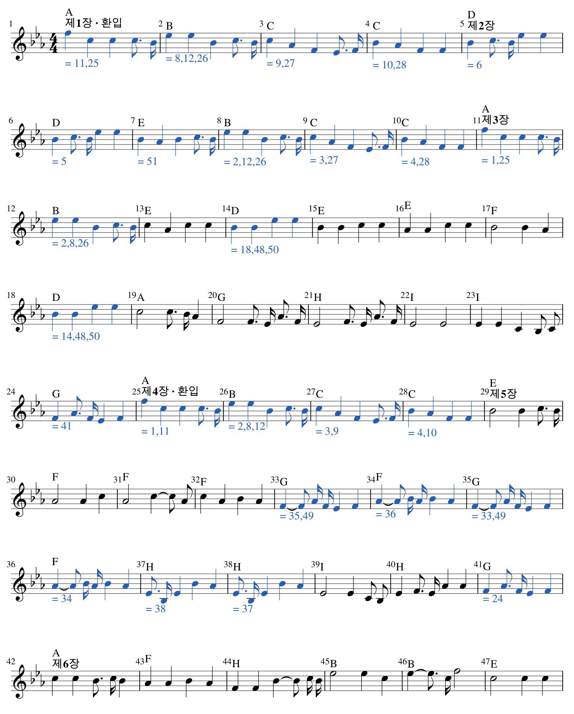{width=16cm}

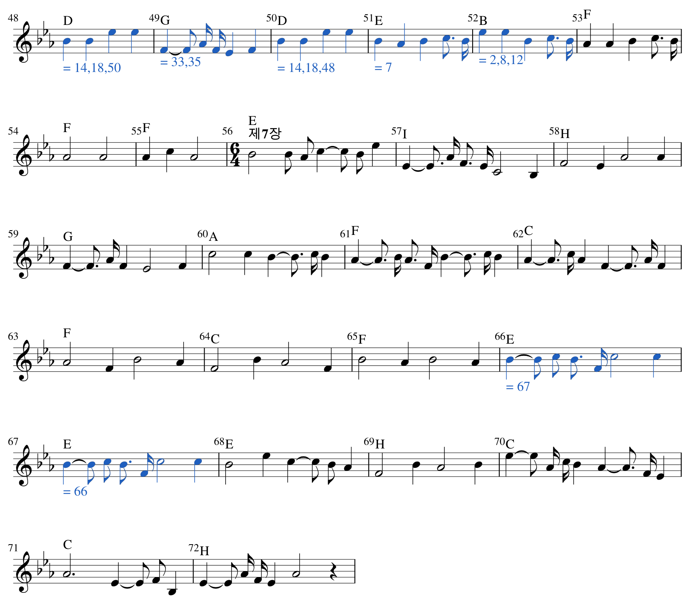{width=16cm}

### K2. 가중치 0

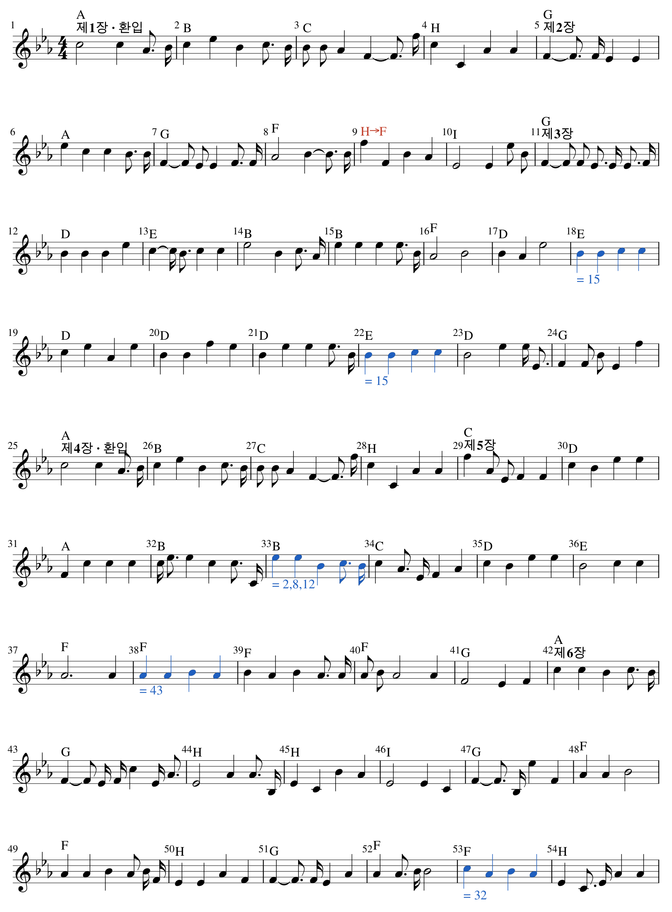{width=16cm}

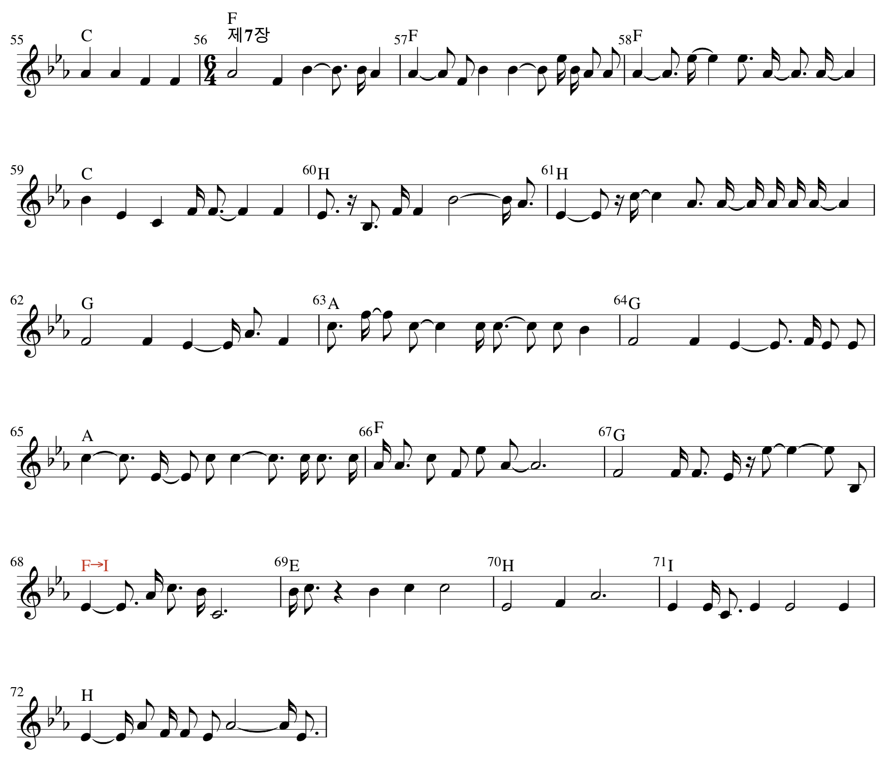{width=16cm}

### K3. 가중치 0.25

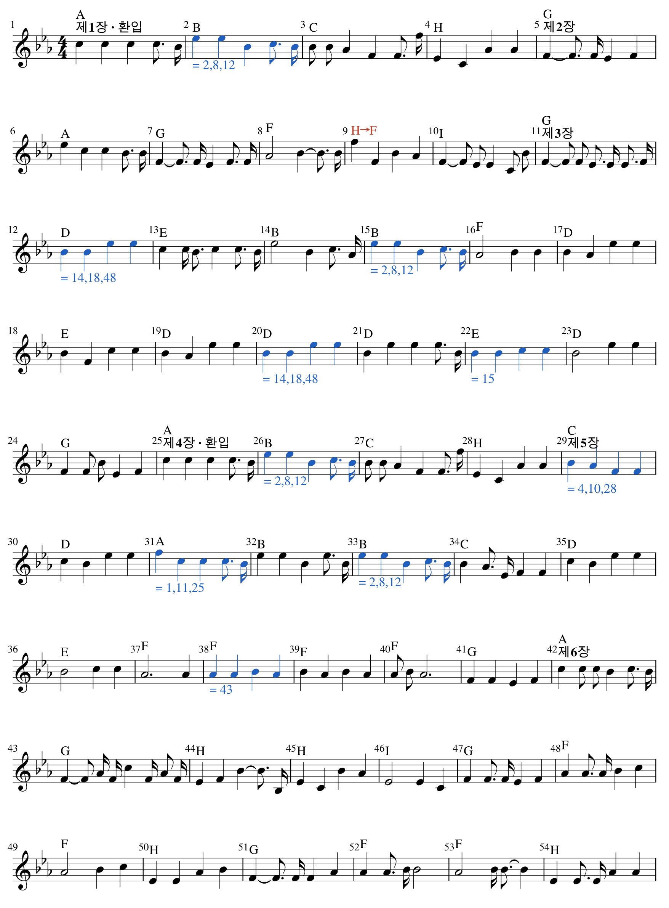{width=16cm}

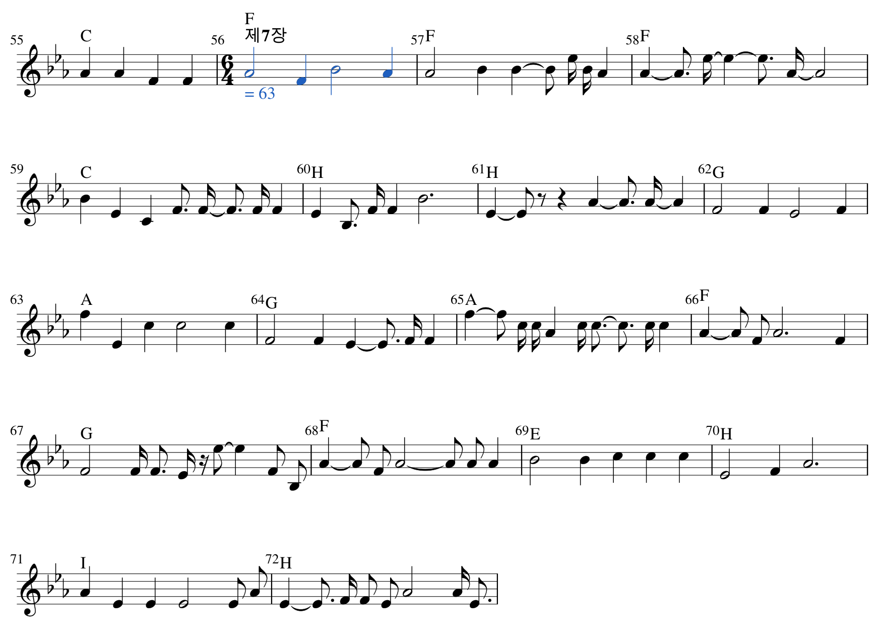{width=16cm}

### K4. 가중치 0.5

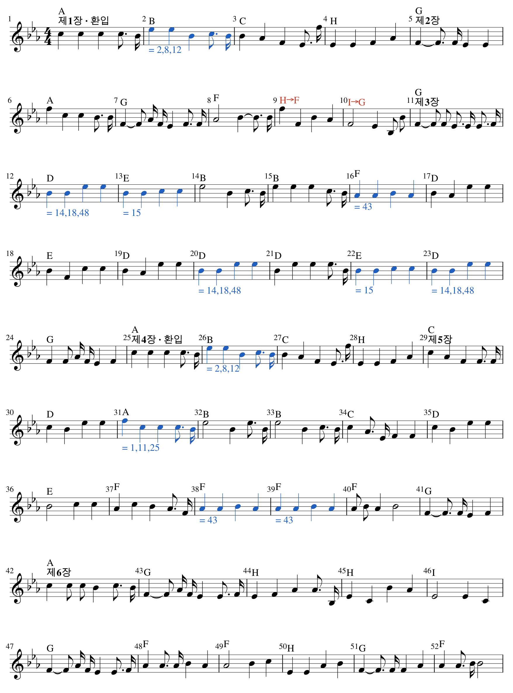{width=16cm}

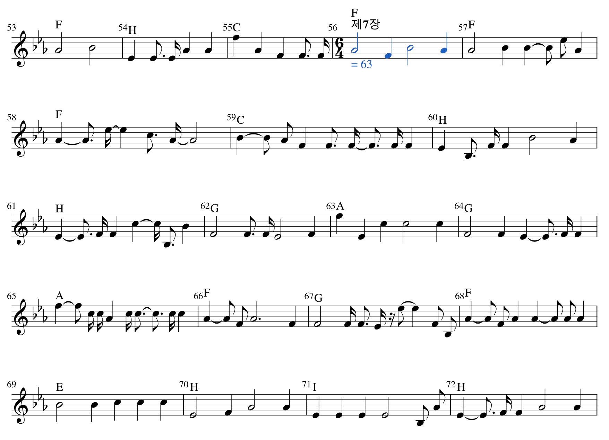{width=16cm}

### K5. 가중치 1

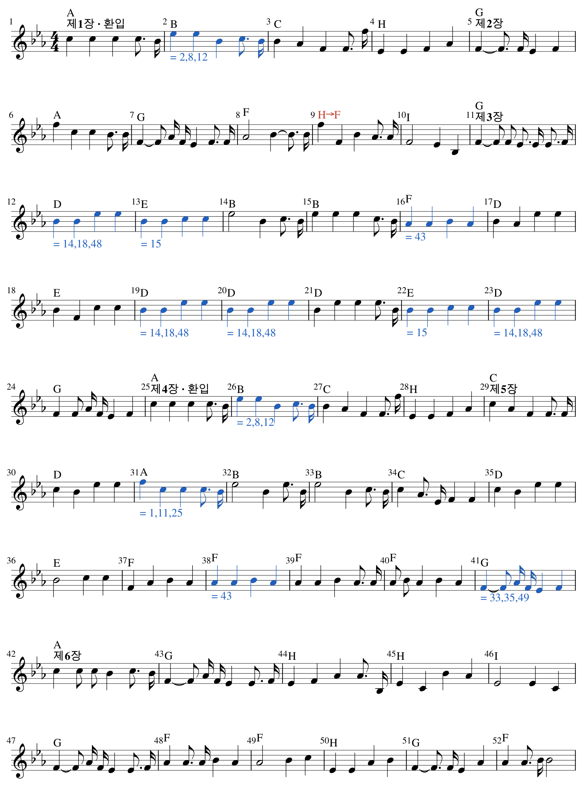{width=16cm}

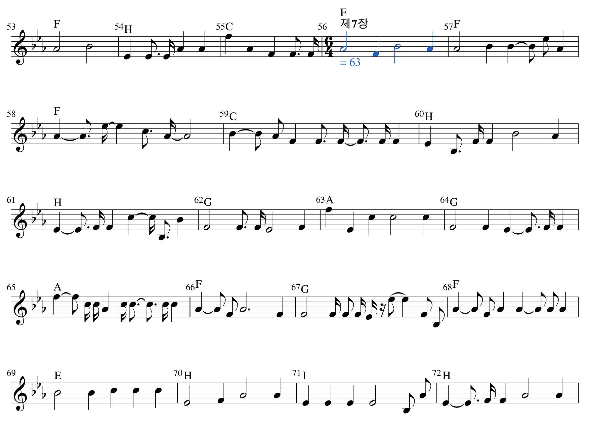{width=16cm}


[^tradeoff]: 맞교환(trade-off)은 공학과 경제학에서 쓰는 말로, 바람직한 두 성질 가운데 한쪽을 높이면 다른 쪽이 낮아지는 관계를 가리킨다. 이 글에서는 생성 마디가 원곡의 유형 구조를 따르는 정도와, 원곡에서 벗어나 새 선율을 만드는 정도 사이의 관계를 뜻한다.

[^pinn]: Maziar Raissi, Paris Perdikaris and George E. Karniadakis, "Physics-Informed Neural Networks: A Deep Learning Framework for Solving Forward and Inverse Problems Involving Nonlinear Partial Differential Equations," *Journal of Computational Physics* 378 (2019), pp. 686–707; Lu Lu, Pengzhan Jin, Guofei Pang, Zhongqiang Zhang and George E. Karniadakis, "Learning Nonlinear Operators via DeepONet Based on the Universal Approximation Theorem of Operators," *Nature Machine Intelligence* 3 (2021), pp. 218–229.

[^manifold]: Yoshua Bengio, Aaron Courville and Pascal Vincent, "Representation Learning: A Review and New Perspectives," *IEEE Transactions on Pattern Analysis and Machine Intelligence* 35(8) (2013), pp. 1798–1828.

[^diffusion]: Jonathan Ho, Ajay Jain and Pieter Abbeel, "Denoising Diffusion Probabilistic Models," *Advances in Neural Information Processing Systems* 33 (2020).

[^1]: 임미선, 「환입」, 국립국악원 『국악사전』, https://www.gugak.go.kr/ency/topic/view/1552 (2026년 11월 10일 접속).

[^2]: 김명옥, 「밑도드리 해금의 TDA Cycle Structure와 선율분석 비교」, 『동양음악』 제51집(서울대학교 동양음악연구소, 2022), 13쪽.

[^3]: 임란경, 「양청도드리」, 국립국악원 『국악사전』, https://www.gugak.go.kr/ency/topic/view/243 (2026년 11월 10일 접속).

[^4]: 임란경, 「우조가락도드리」, 국립국악원 『국악사전』, https://www.gugak.go.kr/ency/topic/view/244 (2026년 11월 10일 접속); 임란경, 「계면가락도드리」, 국립국악원 『국악사전』, https://www.gugak.go.kr/ency/topic/view/561 (2026년 11월 10일 접속).

[^5]: 〈밑도드리〉는 〈보허자〉의 환입 가락을 독립시키고 끝에 환두 가락을 덧붙여 변주한 곡으로, 이를 높여 변주한 곡이 〈웃도드리〉이다. 한영숙, 「밑도드리」, 국립국악원 『국악사전』, https://www.gugak.go.kr/ency/topic/view/253 (2026년 11월 10일 접속).

[^6]: 김명옥, 앞의 글, 17쪽. 분석 대상은 국립국악원 편, 『국악전집 제6집: 여민락·도드리』(국립국악원, 1978)의 해금 악보이며, 시김새는 분석에서 제외되었다(같은 글, 14쪽).

[^7]: 이수경, 「위상수학적 국악 분석에서 사이클의 음악적 의미: 밑도드리, 웃도드리, 타령의 분석을 중심으로」, 『문화와 예술연구』 제27집(동방문화대학원대학교 문화예술콘텐츠연구소, 2024), 243·249쪽.

[^8]: 이와 달리 연주 순서에서 앞으로 돌아가는 반복도 기록되어 있다. 〈계면가락도드리〉는 마지막 제42장단에서 제15장단으로 돌아 들어가 연주할 수 있고, 『삼죽금보』에는 〈우조가락도드리〉의 끝에서 제1장으로 돌아가 반복 연주하는 방식이 기록되어 있다. 임란경, 앞의 「계면가락도드리」·「우조가락도드리」 항목. 본 연구는 악보 안에 적힌 두 구간의 관계만을 다룬다.

[^9]: 김명옥, 앞의 글, 17\~18쪽. 여기서 같은 선율은 6박 한 장단 전체가 같은 경우만을 가리킨다. 이는 6박 중 5박 이상이 일치하면 동일 선율로 본 박혜진의 기준보다 엄격하다(같은 글, 15쪽 및 각주 18).

[^10]: 위의 글, 15\~16·19·24\~25쪽.

[^11]: 예를 들어 〈길군악〉의 돌장1은 첫 장단을 제외하면 초장과 선율이 같고, 〈중영산〉 제5장의 돌장은 제1장을 반복하여 변주한 부분이다. 임미선, 「돌장」, 국립국악원 『국악사전』, https://www.gugak.go.kr/ency/topic/view/1547 (2026년 11월 10일 접속).

[^t21]: Mai Lan Tran, Changbom Park and Jae-Hun Jung, "Topological Data Analysis of Korean Music in Jeongganbo: A Cycle Structure," arXiv:2103.06620 (2021), pp. 6–7; 이수경, 앞의 글, 245쪽. 쪽수는 arXiv판 기준이며, 학술지판(*Journal of Mathematics and Music* 17(3))의 쪽수로 바꾸어야 한다.

[^t21b]: Tran, Park and Jung, 위의 글, 13·25쪽; 이수경, 앞의 글, 247쪽.

[^t21c]: Tran, Park and Jung, 위의 글, 25·26쪽.

[^k22]: 김명옥, 앞의 글, 28\~33쪽.

[^l24]: 이수경, 앞의 글, 251\~255쪽.

[^t22]: Mai Lan Tran, Dongjin Lee and Jae-Hun Jung, "Machine Composition of Korean Music via Topological Data Analysis and Artificial Neural Network," arXiv:2203.15468 (2022), pp. 13–14, 18–20. 학술지판에서 평가가 보완되었는지는 확인이 필요하다.

[^t22b]: 위의 글, p. 14.

[^memorize]: Nicholas Carlini et al., "Extracting Training Data from Diffusion Models," *Proceedings of the 32nd USENIX Security Symposium* (2023).

[^informed]: Laura von Rueden et al., "Informed Machine Learning: A Taxonomy and Survey of Integrating Prior Knowledge into Learning Systems," *IEEE Transactions on Knowledge and Data Engineering* 35(1) (2023), pp. 614–633.

[^masked]: Jacob Austin, Daniel D. Johnson, Jonathan Ho, Daniel Tarlow and Rianne van den Berg, "Structured Denoising Diffusion Models in Discrete State-Spaces," *Advances in Neural Information Processing Systems* 34 (2021); Subham S. Sahoo et al., "Simple and Effective Masked Diffusion Language Models," *Advances in Neural Information Processing Systems* 37 (2024).

[^data]: 전사 자료는 공동저자 김명옥이 오선보로 작성하고 검토하였으며, 이를 MusicXML로 옮겨 사용하였다.

[^mongeau]: Marcel Mongeau and David Sankoff, "Comparison of Musical Sequences," *Computers and the Humanities* 24 (1990), pp. 161–175.

[^pam]: 서로 다른 마디에 등장 횟수를 가중치로 준 k-medoids 군집화를 썼다. Leonard Kaufman and Peter J. Rousseeuw, *Finding Groups in Data: An Introduction to Cluster Analysis* (Wiley, 1990). 무리 수의 선택에는 실루엣 값을 썼다. Peter J. Rousseeuw, "Silhouettes: A Graphical Aid to the Interpretation and Validation of Cluster Analysis," *Journal of Computational and Applied Mathematics* 20 (1987), pp. 53–65.

[^contact]: 이는 위상 보존 신경망에서 쓰는 경쟁 헤브 규칙과 같은 정의다. Thomas Martinetz and Klaus Schulten, "Topology Representing Networks," *Neural Networks* 7(3) (1994), pp. 507–522.

[^sobak]: 「천년만세」, 앞의 항목. 같은 항목은 이 곡을 1분에 160\~180박의 빠르기로 연주한다고 적는다. 한 박을 세 칸으로 나누면 현재 전사의 72마디 가운데 48마디를 적을 수 없으므로, 정간보 원본과 전사의 대응을 확인한 뒤 표현을 정한다.

[^copytest]: Casey Meehan, Kamalika Chaudhuri and Sanjoy Dasgupta, "A Non-Parametric Test to Detect Data-Copying in Generative Models," *Proceedings of the 23rd International Conference on Artificial Intelligence and Statistics* (2020). 최근접 거리에 기댄 지표는 다음을 따랐다. Muhammad Ferjad Naeem, Seong Joon Oh, Youngjung Uh, Yunjey Choi and Jaejun Yoo, "Reliable Fidelity and Diversity Metrics for Generative Models," *Proceedings of the 37th International Conference on Machine Learning* (2020); Ahmed M. Alaa, Boris van Breugel, Evgeny Saveliev and Mihaela van der Schaar, "How Faithful is your Synthetic Data? Sample-level Metrics for Evaluating and Auditing Generative Models," *Proceedings of the 39th International Conference on Machine Learning* (2022).

[^jang]: [제7장은 6/4박자로 전사되어 있다. 『국악사전』은 제7장을 한 장단 열두 박의 타령장단으로 설명하므로, 전사의 한 마디가 이 장단과 어떻게 대응하는지는 확인이 필요하다.]{custom-style="Inquiry"} 「천년만세」, 국립국악원 『국악사전』, https://www.gugak.go.kr/ency/topic/view/241 (2026년 11월 13일 접속).

[^k22rep]: 김명옥, 앞의 글, 각주 34.

[^t21d]: Tran, Park and Jung, 앞의 글, 식 (2).
